# 全志 T113 适配从零适配外设教程

## 软件下载

下载地址：

* [全志在线开发者社区 - 资源下载](https://www.aw-ol.com/downloads?cat=5)

TF 卡烧写工具：

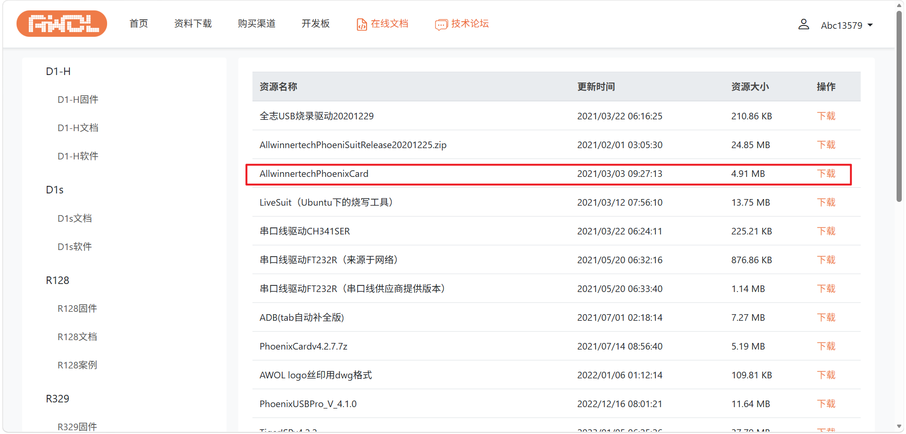


## 环境

### 下载和解压SDK

解压：

~~~shell
tar -xvf T113-Tina5.0-V1.2.tar
~~~

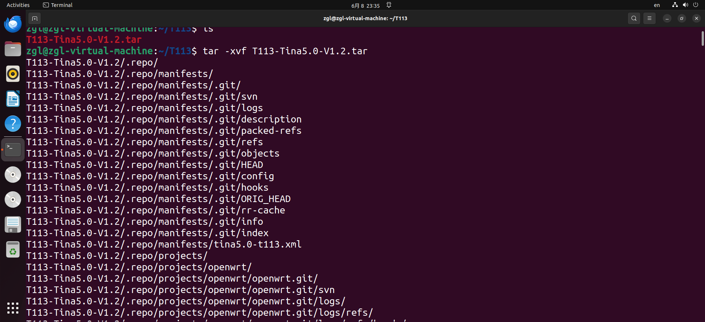

解压成功会有这几个隐藏目录：

```shell
ll
```

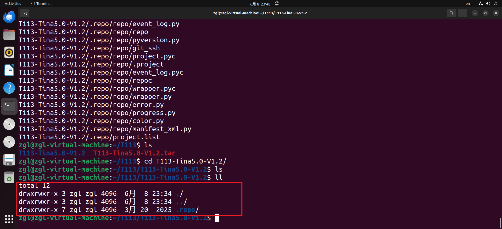

当前 T113 Tina 源码目录**只有.repo 仓库目录**，需要使用命令拉取代码：

~~~shell
.repo/repo/repo sync -l 
~~~

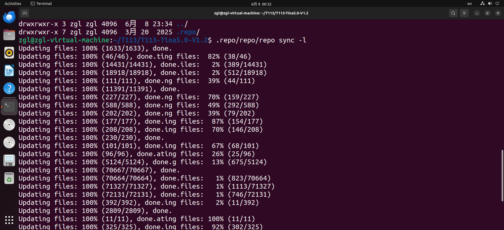

ls 查看拉取的目录：

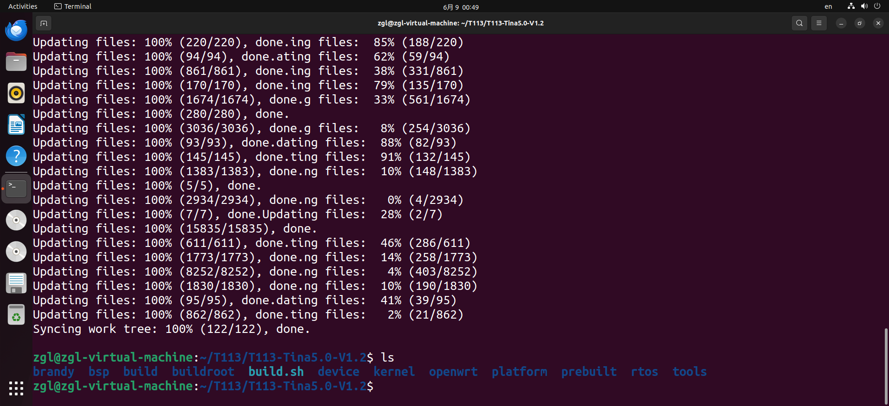

### 创建和配置板级支持包

拉取代码成功后，创建一个新的板级支持包用来编译，看原理图得知板卡使用的是**nand flash**，所以复制一份nand方案，并重新命名为t113-zgl_board（可自行修改）：

~~~shell
cd <sdk_dir>/device/config/chips/t113/configs
cp -r evb1_auto_nand zgl_board
~~~

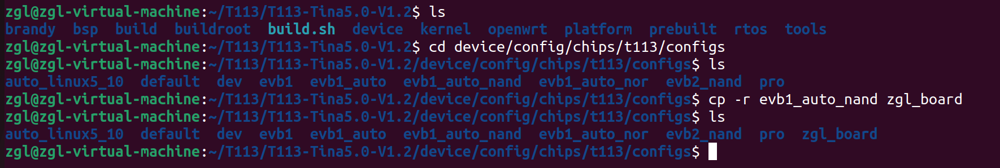

修改 sys_config.fex：

~~~shell
vi custom_board/sys_config.fex
~~~

修改内容：

```shell
;---------------------------------------------------------------------------------
; version:版本1.00
; machine:板级文件名
;---------------------------------------------------------------------------------
[product]
version = "100"
machine = "zgl_board"
```

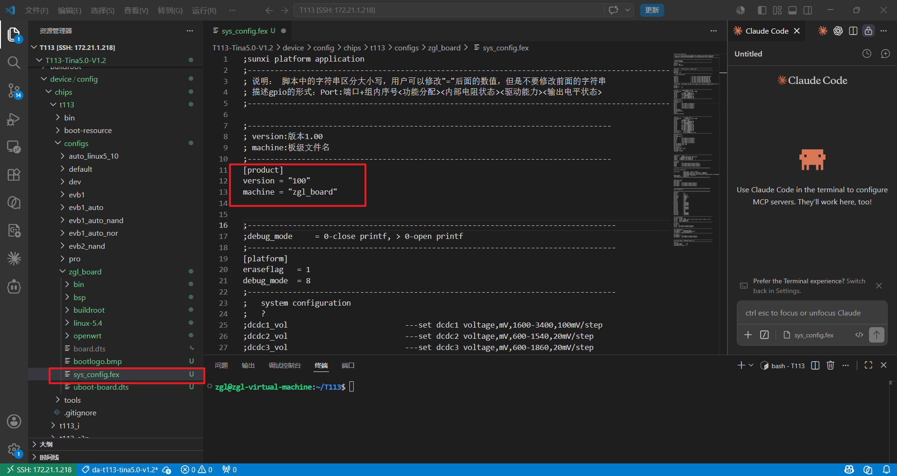

板级方案添加完成，后续外设调试涉及的文件修改将在 zgl_board 目录下完成。

添加openwrt文件系统对自定义板卡的支持方案(注意这里方案名最好与上一步骤的machine名对应)：

进入openwrt文件系统构建目录下：

~~~shell
cd <sdk_dir>/openwrt/target/t113
cp t113-evb1_auto_nand t113-zgl_board -r
cd t113-zgl_board
mv t113_evb1_auto_nand.mk t113_zgl_board.mk
vi t113_zgl_board.mk
~~~

修改 t113_zgl_board.mk 文件:

```mk
$(call inherit-product-if-exists, target/allwinner/t113-common/t113-common.mk)

PRODUCT_PACKAGES +=

PRODUCT_COPY_FILES +=

PRODUCT_AAPT_CONFIG := large xlarge hdpi xhdpi
PRODUCT_AAPT_PERF_CONFIG := xhdpi
PRODUCT_CHARACTERISTICS := musicbox

PRODUCT_BRAND := allwinner
PRODUCT_NAME := t113_zgl_board
PRODUCT_DEVICE := t113-zgl_board
PRODUCT_MODEL := Allwinner t113 zgl_board board
```

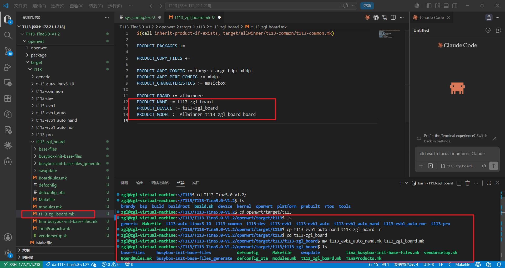

修改 defconfig 和 defconfig_ota 文件(打包openwrt文件系统使用的默认配置)：

~~~shell
vi defconfig 
vi defconfig_ota
~~~

```conf
#
# Automatically generated file; DO NOT EDIT.
# OpenWrt Configuration
#
CONFIG_MODULES=y
CONFIG_HAVE_DOT_CONFIG=y
# CONFIG_TARGET_t113_awol_evb1 is not set
# CONFIG_TARGET_t113_dev is not set
# CONFIG_TARGET_t113_evb1 is not set
# CONFIG_TARGET_t113_evb1_auto is not set
CONFIG_TARGET_t113_zgl_board=y
# CONFIG_TARGET_t113_evb1_auto_nor is not set
# CONFIG_TARGET_t113_pro is not set
CONFIG_TARGET_t113_zgl_board_Default=y
CONFIG_TARGET_BOARD="t113-zgl_board"
```

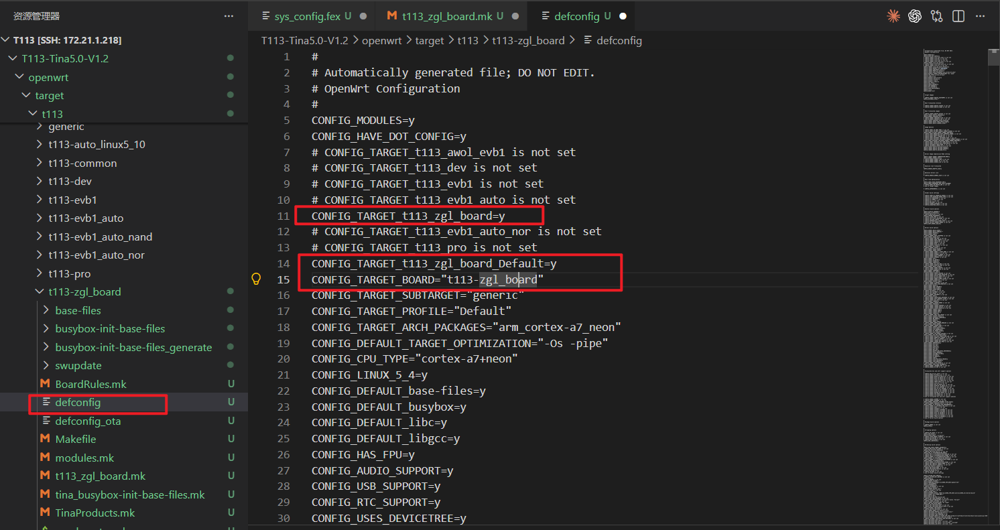

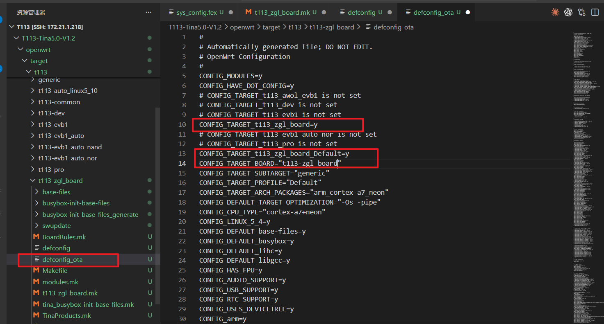

修改 TinaProducts.mk 文件:

```mk
#
# Copyright (C) 2013 The Android Open-Source Project
#
# Licensed under the Apache License, Version 2.0 (the "License");
# you may not use this file except in compliance with the License.
# You may obtain a copy of the License at
#
#      http://www.apache.org/licenses/LICENSE-2.0
#
# Unless required by applicable law or agreed to in writing, software
# distributed under the License is distributed on an "AS IS" BASIS,
# WITHOUT WARRANTIES OR CONDITIONS OF ANY KIND, either express or implied.
# See the License for the specific language governing permissions and
# limitations under the License.
#

PRODUCT_MAKEFILES := \
    $(LOCAL_DIR)/t113_zgl_board.mk
```

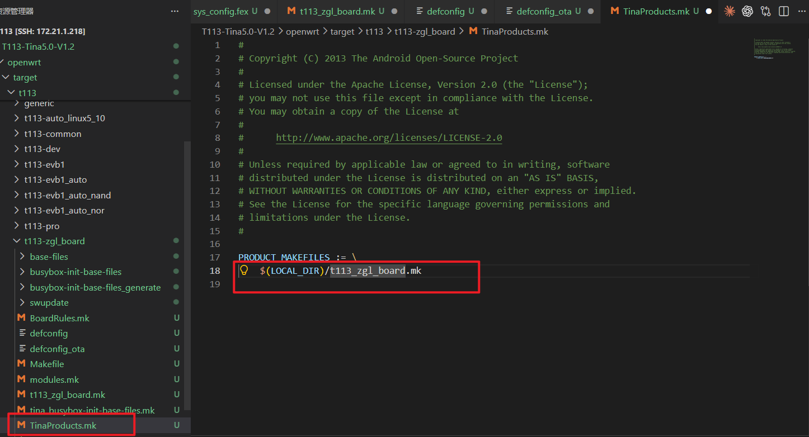

修改 vendorsetup.sh 文件：

~~~shell
vi vendorsetup.sh
~~~

~~~shell
add_lunch_combo t113-zgl_board
~~~

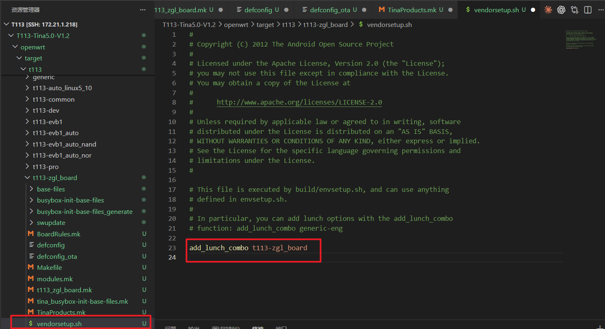

修改 Makefile文件：

~~~shell
vi Makefile
~~~

~~~makefile
#
# Copyright (C) 2013-2016 OpenWrt.org
#
# This is free software, licensed under the GNU General Public License v2.
# See /LICENSE for more information.
#

include $(TOPDIR)/rules.mk

ARCH:=arm
BOARD:=t113-zgl_board
BOARDNAME:=t113-zgl_board
FEATURES:=fpu dt
CPU_TYPE:=cortex-a7
CPU_SUBTYPE:=neon
MAINTAINER:=Allwinner

KERNEL_PATCHVER:=5.4
UBOOT_PATCHVER:=2018
KERNELNAME:=zImage dtbs

include $(INCLUDE_DIR)/target.mk
~~~

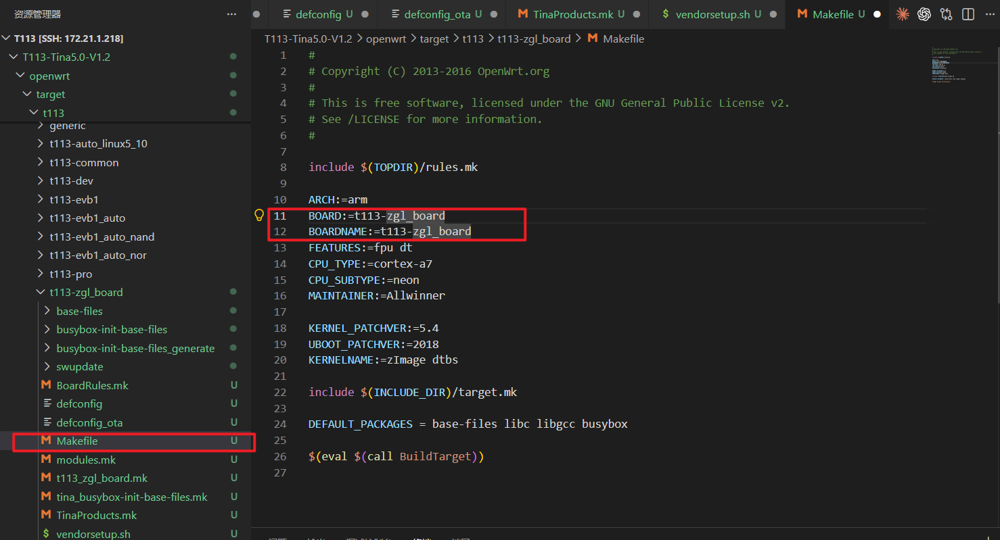

### 编译

创建和配置完成后进行编译：

~~~shell
source build/envsetup.sh
~~~

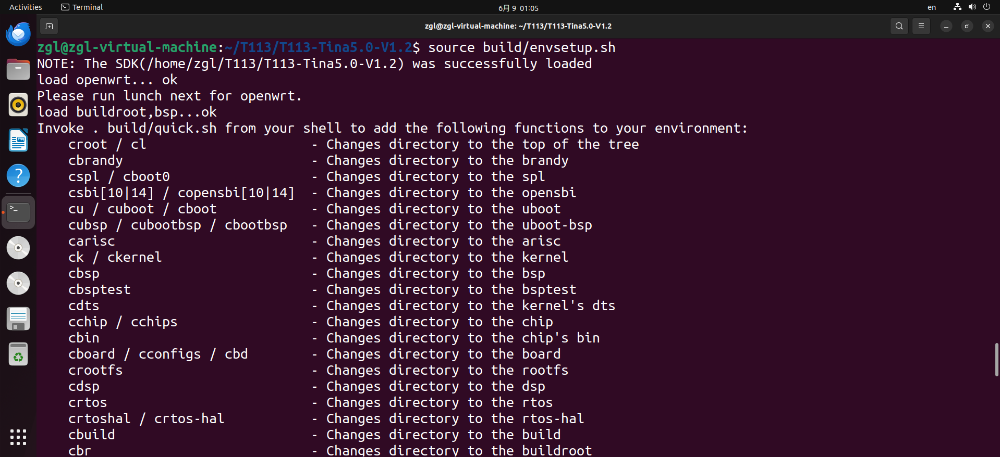

执行命令选择 t113-zgl_board：(即自定义添加的选项，排在17)

~~~shell
lunch
~~~

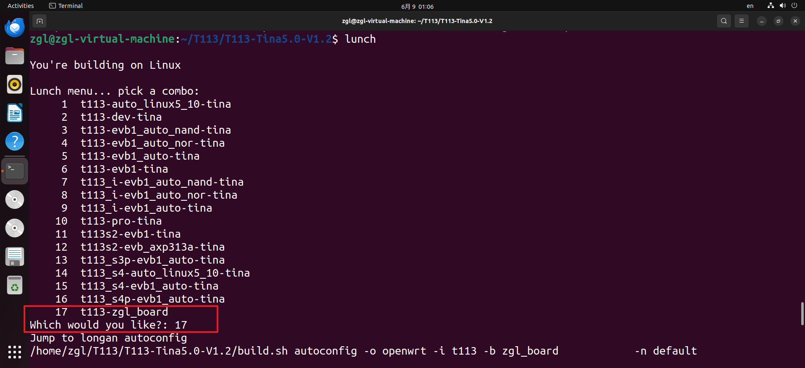

然后编译 openwrt 系统：

~~~shell
make -j1 V=s
~~~

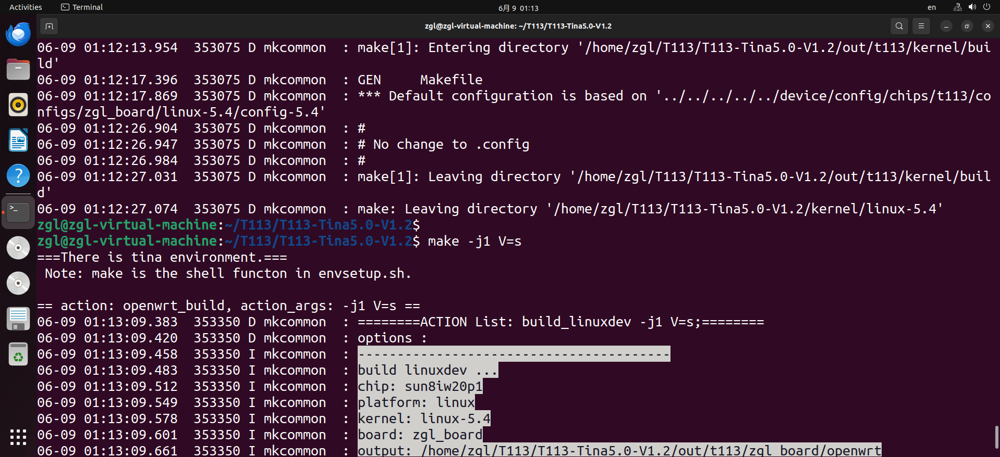

编译成功：

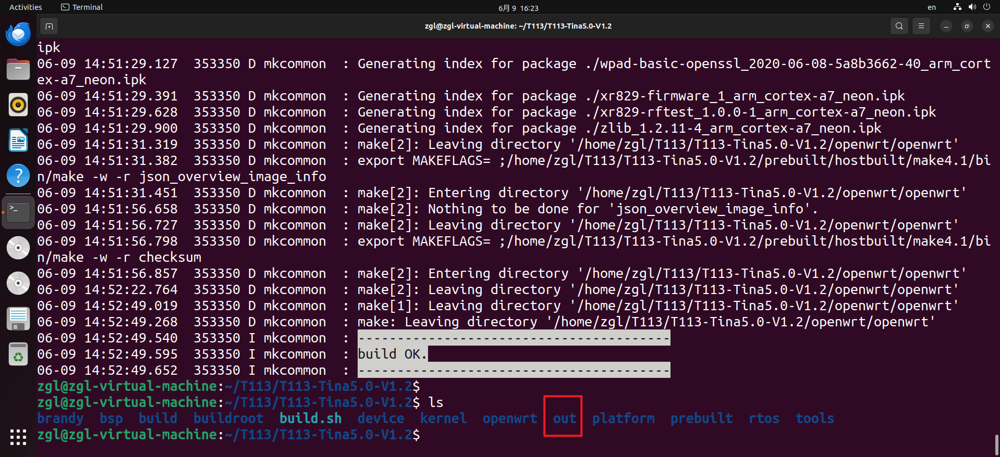

打包镜像：

~~~shell
pack
~~~

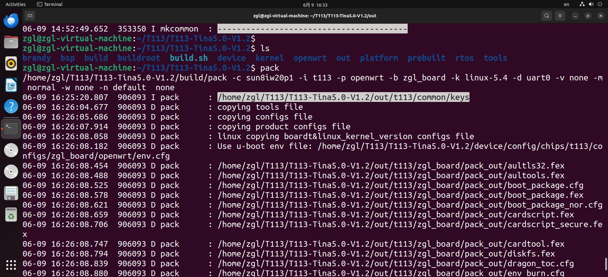

查看生成的镜像

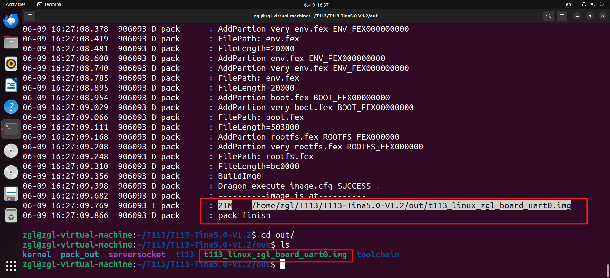

### 烧录镜像

使用全志的烧录工具 AllwinnertechPhoeniSuit 进行烧录，先按住 load，再按rst后松开，最后松开load：

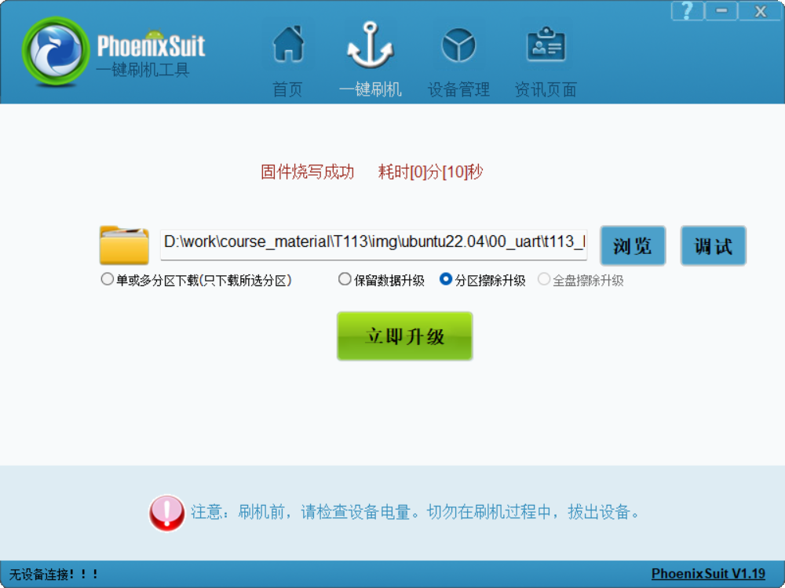


## 外设适配

### 串口

#### 修改 U-Boot 调试串口

uboot和内核调试的串口是同一个，查看原理图确定引脚：

* UART3_TX 对应 PB6
* UART3_RX 对应 PB7

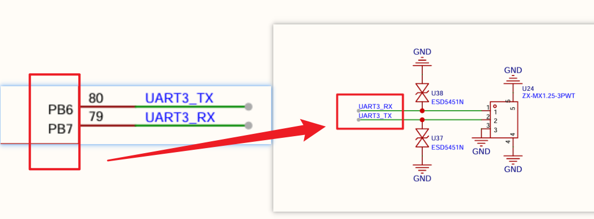

查数据手册：

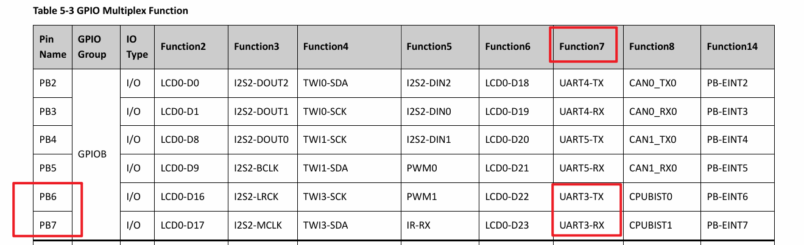

修改 sys_config.fex：

~~~shell
vi <sdk_dir>/device/config/chips/t113/configs/zgl_board/sys_config
~~~

修改内容：

```fex
;----------------------------------------------------------------------------------
;uart configuration
;uart_debug_port  |Boot串口控制器编号        |
;uart_debug_tx       |Boot串口发送的GPIO配置|
;uart_debug_rx  |Boot串口接收的GPIO配置     |
;----------------------------------------------------------------------------------
[uart_para]
uart_debug_port = 3
uart_debug_tx   = port:PB06<7><1><default><default>
uart_debug_rx   = port:PB07<7><1><default><default>
```

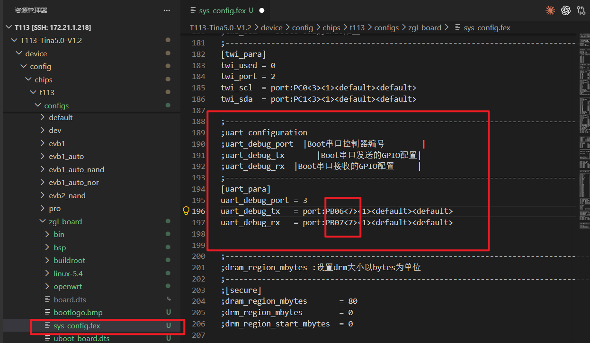

#### 修改内核调试串口

修改设备树 board.dts：

~~~shell
vi <sdk_dir>/device/config/chips/t113/configs/zgl_board/board.dts
~~~

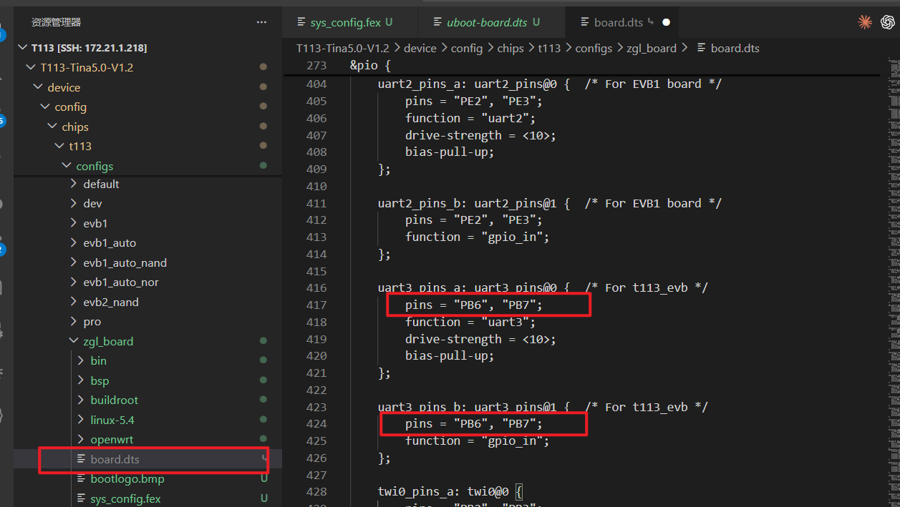

#### 重新编译打包

修改完成后重新编译：

~~~shell
./build.sh kernel      # 重新编译内核（包含 board.dts → dtb）
./build.sh pack        # 重新打包（包含 sys_config.fex）
~~~

解释一下为什么：

- **board.dts** 的修改需要重编内核 → `./build.sh kernel` 会把新的设备树编译进 `sunxi.dtb`
- **sys_config.fex** 的修改不需要编译，只在打包时被读取 → `./build.sh pack` 会把新的 sys_config.fex + 新编译的内核一起打包成 `boot.img`
- `./build.sh uboot` 不需要重编，因为 U-Boot 没改

### 屏幕

屏幕规格：

* 280x1424 分辨率，MIPI DSI 4-lane，FL7707N 驱动芯片，PWM7 背光控制

原理图：

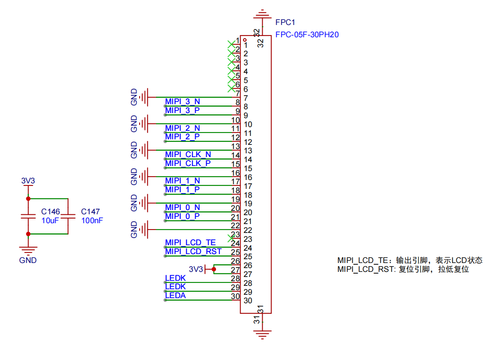

#### U-Boot 适配
##### U-Boot 驱动移植

###### 添加驱动

添加 fl7707 驱动文件：

~~~shell
cd <sdk>/brandy/brandy-2.0/u-boot-2018/drivers/video/sunxi/disp2/disp/lcd
touch fl7707n_mipi.c
touch fl7707n_mipi.h
~~~

fl7707n_mipi.c：

```c
/* fl7707n_mipi.c */

/* drivers/video/sunxi/disp2/disp/lcd/fl7707n_mipi.c
 *
 * Copyright (c) 2017 Allwinnertech Co., Ltd.
 * Author: zhengxiaobin <zhengxiaobin@allwinnertech.com>
 *
 * he0801a-068 panel driver
 *
 * This program is free software; you can redistribute it and/or modify
 * it under the terms of the GNU General Public License version 2 as
 * published by the Free Software Foundation.
 *
*/
#include "fl7707n_mipi.h"

static void lcd_power_on(u32 sel);
static void lcd_power_off(u32 sel);
static void lcd_bl_open(u32 sel);
static void lcd_bl_close(u32 sel);

static void lcd_panel_init(u32 sel);
static void lcd_panel_exit(u32 sel);

#define panel_reset(sel, val) sunxi_lcd_gpio_set_value(sel, 0, val)

static void lcd_cfg_panel_info(panel_extend_para *info)
{
    u32 i = 0, j = 0;
    u32 items;
    u8 lcd_gamma_tbl[][2] = {
        {0, 0},     {15, 15},   {30, 30},   {45, 45},   {60, 60},
        {75, 75},   {90, 90},   {105, 105}, {120, 120}, {135, 135},
        {150, 150}, {165, 165}, {180, 180}, {195, 195}, {210, 210},
        {225, 225}, {240, 240}, {255, 255},
    };

    u32 lcd_cmap_tbl[2][3][4] = {
        {
        {LCD_CMAP_G0, LCD_CMAP_B1, LCD_CMAP_G2, LCD_CMAP_B3},
        {LCD_CMAP_B0, LCD_CMAP_R1, LCD_CMAP_B2, LCD_CMAP_R3},
        {LCD_CMAP_R0, LCD_CMAP_G1, LCD_CMAP_R2, LCD_CMAP_G3},
        },
        {
        {LCD_CMAP_B3, LCD_CMAP_G2, LCD_CMAP_B1, LCD_CMAP_G0},
        {LCD_CMAP_R3, LCD_CMAP_B2, LCD_CMAP_R1, LCD_CMAP_B0},
        {LCD_CMAP_G3, LCD_CMAP_R2, LCD_CMAP_G1, LCD_CMAP_R0},
        },
    };

    items = sizeof(lcd_gamma_tbl) / 2;
    for (i = 0; i < items - 1; i++) {
        u32 num = lcd_gamma_tbl[i + 1][0] - lcd_gamma_tbl[i][0];

        for (j = 0; j < num; j++) {
            u32 value = 0;

            value =
                lcd_gamma_tbl[i][1] +
                ((lcd_gamma_tbl[i + 1][1] - lcd_gamma_tbl[i][1]) *
                 j) /
                num;
            info->lcd_gamma_tbl[lcd_gamma_tbl[i][0] + j] =
                (value << 16) + (value << 8) + value;
        }
    }
    info->lcd_gamma_tbl[255] = (lcd_gamma_tbl[items - 1][1] << 16) +
                   (lcd_gamma_tbl[items - 1][1] << 8) +
                   lcd_gamma_tbl[items - 1][1];

    memcpy(info->lcd_cmap_tbl, lcd_cmap_tbl, sizeof(lcd_cmap_tbl));
}

static s32 lcd_open_flow(u32 sel)
{
    printk("=====================lcd_open_flow\n");
    LCD_OPEN_FUNC(sel, lcd_power_on, 100);
    LCD_OPEN_FUNC(sel, lcd_panel_init, 120);
    LCD_OPEN_FUNC(sel, sunxi_lcd_tcon_enable, 120);
    LCD_OPEN_FUNC(sel, lcd_bl_open, 0);
    return 0;
}

static s32 lcd_close_flow(u32 sel)
{
    printk("=====================lcd_close_flow\n");
    LCD_CLOSE_FUNC(sel, lcd_bl_close, 0);
    LCD_CLOSE_FUNC(sel, lcd_panel_exit, 200);
    LCD_CLOSE_FUNC(sel, sunxi_lcd_tcon_disable, 0);
    LCD_CLOSE_FUNC(sel, lcd_power_off, 500);

    return 0;
}

static void lcd_power_on(u32 sel)
{
    printk("=====================lcd_power_on\n");
    sunxi_lcd_pin_cfg(sel, 1);
    sunxi_lcd_power_enable(sel, 0);
    // sunxi_lcd_power_enable(sel, 1);
    sunxi_lcd_delay_ms(50);

    /* reset lcd by gpio */
    panel_reset(sel, 1);
    sunxi_lcd_delay_ms(5);
    panel_reset(sel, 0);
    sunxi_lcd_delay_ms(10);
    panel_reset(sel, 1);
    sunxi_lcd_delay_ms(120);
    sunxi_lcd_delay_ms(10);
}

static void lcd_power_off(u32 sel)
{
    printk("=====================lcd_power_off\n");
    sunxi_lcd_pin_cfg(sel, 0);
    sunxi_lcd_delay_ms(20);
    panel_reset(sel, 0);
    sunxi_lcd_delay_ms(5);
    sunxi_lcd_power_disable(sel, 0);
}

static void lcd_bl_open(u32 sel)
{
    printk("=====================lcd_bl_open\n");
    sunxi_lcd_pwm_enable(sel);
    sunxi_lcd_backlight_enable(sel);
}

static void lcd_bl_close(u32 sel)
{
    printk("=====================lcd_bl_close\n");
    sunxi_lcd_backlight_disable(sel);
    sunxi_lcd_pwm_disable(sel);
}

#define REGFLAG_DELAY 0XFC
#define REGFLAG_END_OF_TABLE 0xFD /* END OF REGISTERS MARKER */

struct LCM_setting_table {
    u8 cmd;
    u32 count;
    u8 para_list[100];
};

static struct LCM_setting_table lcm_initialization_setting[] = {
    {0xB9, 3,  {0xF1,0x12,0x87} },
    {0xB2, 3,  {0x64,0x05,0x78} },
    {0xB3, 10, {0x10,0x10,0x28,0x28,0x03,0xFF,0x00,0x00,0x00,0x00} },
    {0xB4, 1,  {0x80} },
    {0xB5, 2,  {0x0D,0x0D} },
    {0xB6, 2,  {0x4F,0x4F} },
    {0xB8, 4,  {0x26,0x22,0xF0,0x13} },

    {0xBA, 27, {0x33,0x81,0x05,0xF9,0x0E,0x0E,0x20,0x00,0x00,0x00,0x00,0x00,0x00,0x00,0x44,0x25,0x00,0x91,0x0A,0x00,0x00,0x01,0x4F,0x01,0x00,0x00,0x37} },
    {0xBC, 1,  {0x47} },
    {0xBF, 5,  {0x02,0x10,0x00,0x80,0x04} },

    {0xC0, 9,  {0x73,0x73,0x50,0x50,0x00,0x00,0x12,0x73,0x00} },
    {0xC1, 17, {0x54,0x00,0x32,0x32,0x99,0xE4,0x77,0x77,0xCC,0xCC,0xFF,0xFF,0x11,0x11,0x00,0x00,0x32} },
    {0xC7, 12, {0x10,0x00,0x0A,0x00,0x00,0x00,0x00,0x00,0xED,0xC5,0x00,0xA5} },
    {0xC8, 4,  {0x10,0x40,0x1E,0x03} },
    {0xCC, 1,  {0x0B} },

    {0xE0, 34, {0x00,0x0B,0x12,0x29,0x3C,0x3F,0x47,0x3D,0x06,0x0C,0x0D,0x12,0x13,0x11,0x13,0x13,0x1B,0x00,0x0B,0x12,0x29,0x3C,0x3F,0x47,0x3D,0x06,0x0C,0x0D,0x12,0x13,0x11,0x13,0x13,0x1B} },
    {0xE1, 7,  {0x11,0x11,0x91,0x00,0x00,0x00,0x00} },
    {0xE3, 14, {0x07,0x07,0x0B,0x0B,0x0B,0x0B,0x00,0x00,0x00,0x00,0xFF,0x04,0xC0,0x10} },
    {0xE9, 63, {0xC8,0x10,0x0A,0x10,0x0D,0x80,0x38,0x12,0x31,0x23,0x4F,0x86,0x80,0x38,0x47,0x08,0x00,0x00,0x4F,0x00,0x00,0x04,0x00,0x00,0x4F,0x00,0x00,0x04,0x94,0xA3,0xF8,0x18,0x13,0x57,0x88,0x88,0x88,0x88,0x88,0x94,0xA2,0xF8,0x08,0x02,0x46,0x88,0x88,0x88,0x88,0x88,0x00,0x00,0x00,0x01,0x00,0x80,0x38,0x00,0x00,0x00,0x00,0x00,0x00} },
    {0xEA, 61, {0x00,0x1A,0x00,0x00,0x00,0x00,0x01,0x0A,0x41,0x01,0x02,0x00,0x94,0xA0,0x8F,0x28,0x64,0x20,0x88,0x88,0x88,0x88,0x88,0x94,0xA1,0x8F,0x38,0x75,0x31,0x88,0x88,0x88,0x88,0x88,0x23,0x00,0x00,0x00,0xD3,0x00,0x00,0x00,0x00,0x00,0x00,0x00,0x00,0x00,0x00,0x00,0x05,0xAA,0x00,0x00,0x40,0x80,0x38,0x40,0x80,0x38,0x00} },

    {0xEF, 3,  {0xFF,0xFF,0x01} },

    {0x11, 0, {} },
    {REGFLAG_DELAY, REGFLAG_DELAY, {250} },

    {0x29, 0, {} },
    {REGFLAG_DELAY, REGFLAG_DELAY, {50} },
    {REGFLAG_END_OF_TABLE, REGFLAG_END_OF_TABLE, {} }
};

static void lcd_panel_init(u32 sel)
{
    u32 i = 0;

    sunxi_lcd_dsi_clk_enable(sel);
    sunxi_lcd_delay_ms(100);

    for (i = 0;; i++) {
        if (lcm_initialization_setting[i].cmd == REGFLAG_END_OF_TABLE)
            break;
        else if (lcm_initialization_setting[i].cmd == REGFLAG_DELAY)
            sunxi_lcd_delay_ms(lcm_initialization_setting[i].count);
        else {
            dsi_dcs_wr(0, lcm_initialization_setting[i].cmd,
                   lcm_initialization_setting[i].para_list,
                   lcm_initialization_setting[i].count);
        }
    }
}

static void lcd_panel_exit(u32 sel)
{
    sunxi_lcd_dsi_dcs_write_0para(sel, 0x28);
    sunxi_lcd_delay_ms(80);
    sunxi_lcd_dsi_dcs_write_0para(sel, 0x10);
    sunxi_lcd_delay_ms(50);
}

/*sel: 0:lcd0; 1:lcd1*/
static s32 lcd_user_defined_func(u32 sel, u32 para1, u32 para2, u32 para3)
{
    return 0;
}

__lcd_panel_t fl7707n_mipi_panel = {
    /* panel driver name, must mach the name of
     * lcd_drv_name in sys_config.fex
     */
    .name = "fl7707n_mipi",
    .func = {
        .cfg_panel_info = lcd_cfg_panel_info,
        .cfg_open_flow = lcd_open_flow,
        .cfg_close_flow = lcd_close_flow,
        .lcd_user_defined_func = lcd_user_defined_func,
    },
};
```

 fl7707n_mipi.h：

```c
/* fl7707n_mipi.h */

#ifndef _FL7707N_MIPI_H
#define _FL7707N_MIPI_H

#include "panels.h"

extern __lcd_panel_t fl7707n_mipi_panel;

extern s32 bsp_disp_get_panel_info(u32 screen_id, disp_panel_para *info);

#endif /*End of file*/

```

###### 修改 Makefile

修改 Makefile：

```shell
vi <sdk>/brandy/brandy-2.0/u-boot-2018/drivers/video/sunxi/disp2/disp/Makefile
```

修改内容：

```Makefile
disp-$(CONFIG_LCD_SUPPORT_ILI9881T_INCELL_800X1280) += lcd/ILI9881T_INCELL_800X1280.o
disp-$(CONFIG_LCD_SUPPORT_FL7707N_MIPI) += lcd/fl7707n_mipi.o       <--------------- 添加
disp-y += lcd/SQ101D_Q5DI404_84H501H.o
```

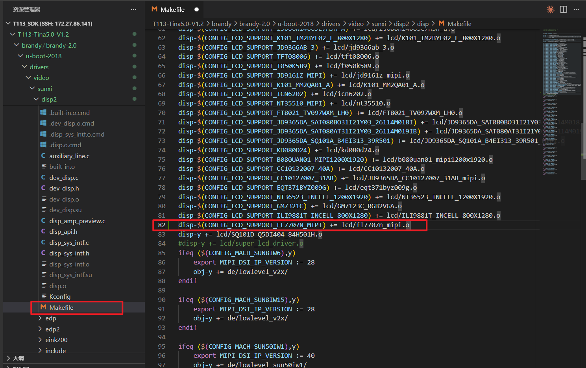

###### 修改 Kconfig

修改 Kconfig：

```shell
vi <sdk>/brandy/brandy-2.0/u-boot-2018/drivers/video/sunxi/disp2/disp/lcd/Kconfig
```

修改内容：

```shell
config LCD_SUPPORT_FL7707N_MIPI
    bool "LCD support FL7707N_MIPI panel"
    default n
    help
        If you want to support FL7707N_MIPI panel for display driver, select it.
```

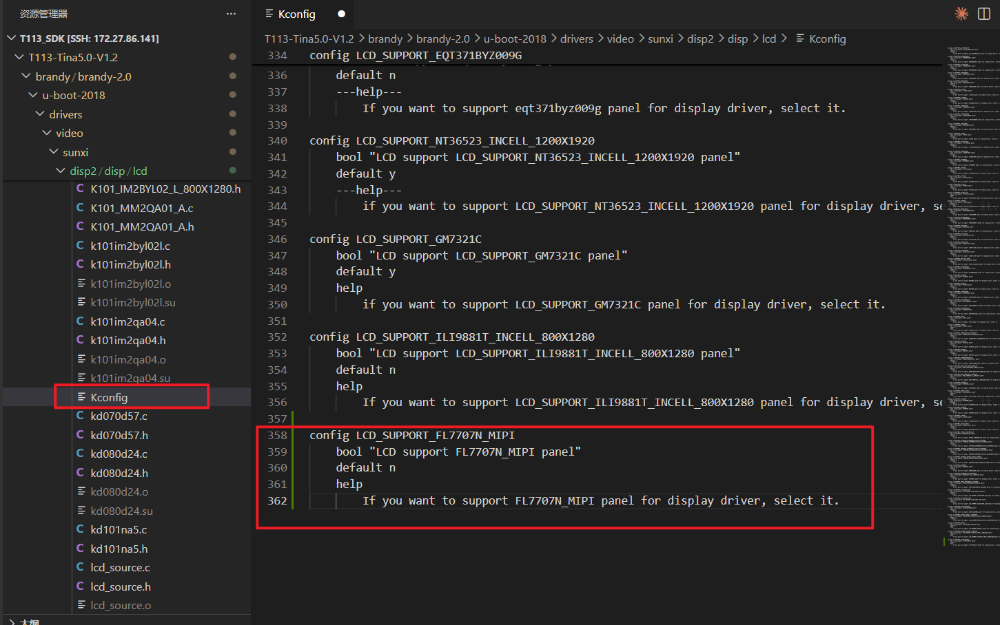

##### U-Boot Menuconfig 配置

修改 sun8iw20p1_auto_defconfig：

```shell
vi <sdk>/brandy/brandy-2.0/u-boot-2018/configs/sun8iw20p1_auto_defconfig
```

修改内容：

```shell
CONFIG_LCD_SUPPORT_FL7707N_MIPI=y
```

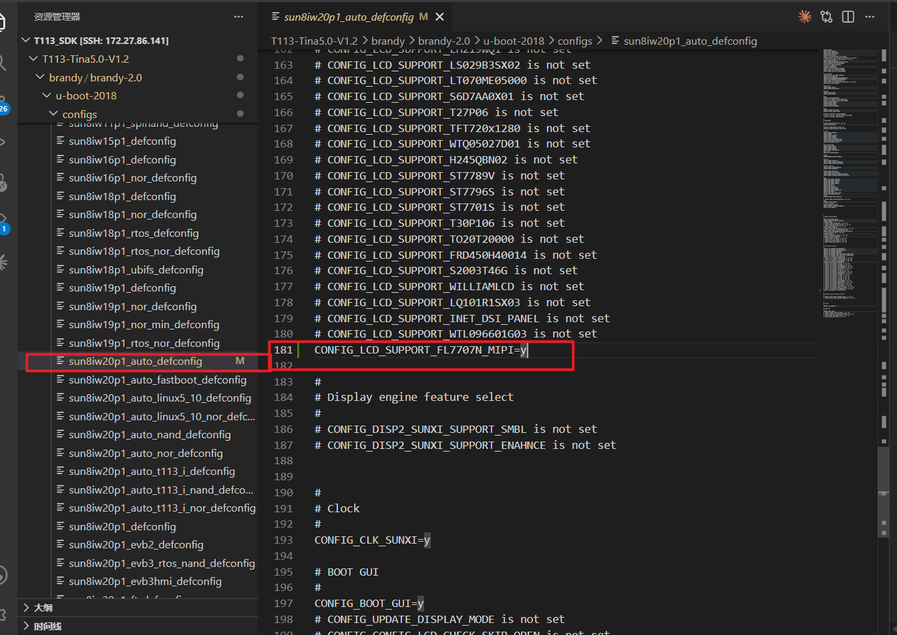

##### U-Boot 设备树配置

修改设备树：
```shell
vi <sdk>/device/config/chips/t113/configs/zgl_board/uboot-board.dts
```

修改内容：

```dts
&lcd0 {
	lcd_used            = <1>;			// 启用lcd

	lcd_driver_name     = "fl7707n_mipi";// lcd 驱动名称
	lcd_backlight       = <50>;
	lcd_if              = <4>;			// 0:rgb 4:dsi

	lcd_x               = <280>;		// 宽度
	lcd_y               = <1424>;		// 像素高度
	lcd_width           = <72>;			// 屏幕物理宽度，单位 mm
	lcd_height          = <171>;		// 屏幕物理高度，单位 mm
	lcd_dclk_freq       = <63>;			// 屏幕时钟，单位 MHz lcd_ht * lcd_vt * 60

	lcd_pwm_used        = <1>;			// 启用背光 PWM
	lcd_pwm_ch          = <7>;			// 使用 PWM 通道 7
	lcd_pwm_freq        = <10000>;		// PWM 频率，单位 Hz
	lcd_pwm_pol         = <0>;			// 背光 PWM 的极性
	lcd_pwm_max_limit   = <255>;

	lcd_hbp             = <90>;			// hsync back porch(pixel) + hsync plus width(pixel);
	lcd_ht              = <850>;		// hsync total cycle(pixel)
	lcd_hspw            = <30>;			// hsync plus width(pixel)
	lcd_vbp             = <18>;			// vsync back porch(line) + vysnc plus width(line)  
	lcd_vt              = <1457>;		// vsync total cycle(line)
	lcd_vspw            = <3>;			// vsync plus width(pixel)

	lcd_dsi_lane        = <4>;
	lcd_dsi_if          = <0>;
	lcd_dsi_format      = <0>;
	lcd_dsi_te          = <0>;
	lcd_frm             = <0>;
	lcd_io_phase        = <0>;
	lcd_gamma_en        = <0>;
	lcd_bright_curve_en = <0>;
	lcd_cmap_en         = <0>;

	deu_mode            = <0>;
	lcdgamma4iep        = <22>;
	smart_color         = <90>;

	lcd_gpio_0 = <&pio PD 20 GPIO_ACTIVE_HIGH>;// lcd reset  

	pinctrl-0 = <&dsi4lane_pins_a>;
	pinctrl-1 = <&dsi4lane_pins_b>;
};
```

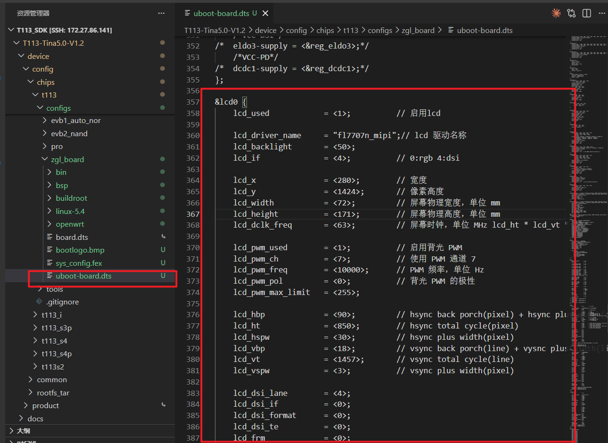


#### 内核适配
##### 内核驱动移植

###### 添加驱动

添加 fl7707 驱动文件：

```shell
cd <sdk>/kernel/linux-5.4/drivers/video/fbdev/sunxi/disp2/disp/lcd
touch fl7707n_mipi.c
touch fl7707n_mipi.h
```

fl7707n_mipi.c：

```c
/* fl7707n_mipi.c */

/* drivers/video/sunxi/disp2/disp/lcd/fl7707n_mipi.c
 *
 * Copyright (c) 2017 Allwinnertech Co., Ltd.
 * Author: zhengxiaobin <zhengxiaobin@allwinnertech.com>
 *
 * he0801a-068 panel driver
 *
 * This program is free software; you can redistribute it and/or modify
 * it under the terms of the GNU General Public License version 2 as
 * published by the Free Software Foundation.
 *
*/
#include "fl7707n_mipi.h"

static void lcd_power_on(u32 sel);
static void lcd_power_off(u32 sel);
static void lcd_bl_open(u32 sel);
static void lcd_bl_close(u32 sel);

static void lcd_panel_init(u32 sel);
static void lcd_panel_exit(u32 sel);

#define panel_reset(sel, val) sunxi_lcd_gpio_set_value(sel, 0, val)

static void lcd_cfg_panel_info(struct panel_extend_para *info)
{
    u32 i = 0, j = 0;
    u32 items;
    u8 lcd_gamma_tbl[][2] = {
        {0, 0},     {15, 15},   {30, 30},   {45, 45},   {60, 60},
        {75, 75},   {90, 90},   {105, 105}, {120, 120}, {135, 135},
        {150, 150}, {165, 165}, {180, 180}, {195, 195}, {210, 210},
        {225, 225}, {240, 240}, {255, 255},
    };

    u32 lcd_cmap_tbl[2][3][4] = {
        {
        {LCD_CMAP_G0, LCD_CMAP_B1, LCD_CMAP_G2, LCD_CMAP_B3},
        {LCD_CMAP_B0, LCD_CMAP_R1, LCD_CMAP_B2, LCD_CMAP_R3},
        {LCD_CMAP_R0, LCD_CMAP_G1, LCD_CMAP_R2, LCD_CMAP_G3},
        },
        {
        {LCD_CMAP_B3, LCD_CMAP_G2, LCD_CMAP_B1, LCD_CMAP_G0},
        {LCD_CMAP_R3, LCD_CMAP_B2, LCD_CMAP_R1, LCD_CMAP_B0},
        {LCD_CMAP_G3, LCD_CMAP_R2, LCD_CMAP_G1, LCD_CMAP_R0},
        },
    };

    items = sizeof(lcd_gamma_tbl) / 2;
    for (i = 0; i < items - 1; i++) {
        u32 num = lcd_gamma_tbl[i + 1][0] - lcd_gamma_tbl[i][0];

        for (j = 0; j < num; j++) {
            u32 value = 0;

            value =
                lcd_gamma_tbl[i][1] +
                ((lcd_gamma_tbl[i + 1][1] - lcd_gamma_tbl[i][1]) *
                 j) /
                num;
            info->lcd_gamma_tbl[lcd_gamma_tbl[i][0] + j] =
                (value << 16) + (value << 8) + value;
        }
    }
    info->lcd_gamma_tbl[255] = (lcd_gamma_tbl[items - 1][1] << 16) +
                   (lcd_gamma_tbl[items - 1][1] << 8) +
                   lcd_gamma_tbl[items - 1][1];

    memcpy(info->lcd_cmap_tbl, lcd_cmap_tbl, sizeof(lcd_cmap_tbl));
}

static s32 lcd_open_flow(u32 sel)
{
    printk("=====================lcd_open_flow\n");
    LCD_OPEN_FUNC(sel, lcd_power_on, 100);
    LCD_OPEN_FUNC(sel, lcd_panel_init, 120);
    LCD_OPEN_FUNC(sel, sunxi_lcd_tcon_enable, 120);
    LCD_OPEN_FUNC(sel, lcd_bl_open, 0);
    return 0;
}

static s32 lcd_close_flow(u32 sel)
{
    printk("=====================lcd_close_flow\n");
    LCD_CLOSE_FUNC(sel, lcd_bl_close, 0);
    LCD_CLOSE_FUNC(sel, lcd_panel_exit, 200);
    LCD_CLOSE_FUNC(sel, sunxi_lcd_tcon_disable, 0);
    LCD_CLOSE_FUNC(sel, lcd_power_off, 500);

    return 0;
}

static void lcd_power_on(u32 sel)
{
    printk("=====================lcd_power_on\n");
    sunxi_lcd_pin_cfg(sel, 1);
    sunxi_lcd_power_enable(sel, 0);
    // sunxi_lcd_power_enable(sel, 1);
    sunxi_lcd_delay_ms(50);

    /* reset lcd by gpio */
    panel_reset(sel, 1);
    sunxi_lcd_delay_ms(5);
    panel_reset(sel, 0);
    sunxi_lcd_delay_ms(10);
    panel_reset(sel, 1);
    sunxi_lcd_delay_ms(120);
    sunxi_lcd_delay_ms(10);
}

static void lcd_power_off(u32 sel)
{
    printk("=====================lcd_power_off\n");
    sunxi_lcd_pin_cfg(sel, 0);
    sunxi_lcd_delay_ms(20);
    panel_reset(sel, 0);
    sunxi_lcd_delay_ms(5);
    sunxi_lcd_power_disable(sel, 0);
}

static void lcd_bl_open(u32 sel)
{
    printk("=====================lcd_bl_open\n");
    sunxi_lcd_pwm_enable(sel);
    sunxi_lcd_backlight_enable(sel);
}

static void lcd_bl_close(u32 sel)
{
    printk("=====================lcd_bl_close\n");
    sunxi_lcd_backlight_disable(sel);
    sunxi_lcd_pwm_disable(sel);
}

#define REGFLAG_DELAY 0XFC
#define REGFLAG_END_OF_TABLE 0xFD /* END OF REGISTERS MARKER */

struct LCM_setting_table {
    u8 cmd;
    u32 count;
    u8 para_list[100];
};

static struct LCM_setting_table lcm_initialization_setting[] = {
    {0xB9, 3,  {0xF1,0x12,0x87} },
    {0xB2, 3,  {0x64,0x05,0x78} },
    {0xB3, 10, {0x10,0x10,0x28,0x28,0x03,0xFF,0x00,0x00,0x00,0x00} },
    {0xB4, 1,  {0x80} },
    {0xB5, 2,  {0x0D,0x0D} },
    {0xB6, 2,  {0x4F,0x4F} },
    {0xB8, 4,  {0x26,0x22,0xF0,0x13} },

    {0xBA, 27, {0x33,0x81,0x05,0xF9,0x0E,0x0E,0x20,0x00,0x00,0x00,0x00,0x00,0x00,0x00,0x44,0x25,0x00,0x91,0x0A,0x00,0x00,0x01,0x4F,0x01,0x00,0x00,0x37} },
    {0xBC, 1,  {0x47} },
    {0xBF, 5,  {0x02,0x10,0x00,0x80,0x04} },

    {0xC0, 9,  {0x73,0x73,0x50,0x50,0x00,0x00,0x12,0x73,0x00} },
    {0xC1, 17, {0x54,0x00,0x32,0x32,0x99,0xE4,0x77,0x77,0xCC,0xCC,0xFF,0xFF,0x11,0x11,0x00,0x00,0x32} },
    {0xC7, 12, {0x10,0x00,0x0A,0x00,0x00,0x00,0x00,0x00,0xED,0xC5,0x00,0xA5} },
    {0xC8, 4,  {0x10,0x40,0x1E,0x03} },
    {0xCC, 1,  {0x0B} },

    {0xE0, 34, {0x00,0x0B,0x12,0x29,0x3C,0x3F,0x47,0x3D,0x06,0x0C,0x0D,0x12,0x13,0x11,0x13,0x13,0x1B,0x00,0x0B,0x12,0x29,0x3C,0x3F,0x47,0x3D,0x06,0x0C,0x0D,0x12,0x13,0x11,0x13,0x13,0x1B} },
    {0xE1, 7,  {0x11,0x11,0x91,0x00,0x00,0x00,0x00} },
    {0xE3, 14, {0x07,0x07,0x0B,0x0B,0x0B,0x0B,0x00,0x00,0x00,0x00,0xFF,0x04,0xC0,0x10} },
    {0xE9, 63, {0xC8,0x10,0x0A,0x10,0x0D,0x80,0x38,0x12,0x31,0x23,0x4F,0x86,0x80,0x38,0x47,0x08,0x00,0x00,0x4F,0x00,0x00,0x04,0x00,0x00,0x4F,0x00,0x00,0x04,0x94,0xA3,0xF8,0x18,0x13,0x57,0x88,0x88,0x88,0x88,0x88,0x94,0xA2,0xF8,0x08,0x02,0x46,0x88,0x88,0x88,0x88,0x88,0x00,0x00,0x00,0x01,0x00,0x80,0x38,0x00,0x00,0x00,0x00,0x00,0x00} },
    {0xEA, 61, {0x00,0x1A,0x00,0x00,0x00,0x00,0x01,0x0A,0x41,0x01,0x02,0x00,0x94,0xA0,0x8F,0x28,0x64,0x20,0x88,0x88,0x88,0x88,0x88,0x94,0xA1,0x8F,0x38,0x75,0x31,0x88,0x88,0x88,0x88,0x88,0x23,0x00,0x00,0x00,0xD3,0x00,0x00,0x00,0x00,0x00,0x00,0x00,0x00,0x00,0x00,0x00,0x05,0xAA,0x00,0x00,0x40,0x80,0x38,0x40,0x80,0x38,0x00} },

    {0xEF, 3,  {0xFF,0xFF,0x01} },

    {0x11, 0, {} },
    {REGFLAG_DELAY, REGFLAG_DELAY, {250} },

    {0x29, 0, {} },
    {REGFLAG_DELAY, REGFLAG_DELAY, {50} },
    {REGFLAG_END_OF_TABLE, REGFLAG_END_OF_TABLE, {} }
};

static void lcd_panel_init(u32 sel)
{
    u32 i = 0;

    sunxi_lcd_dsi_clk_enable(sel);
    sunxi_lcd_delay_ms(100);

    for (i = 0;; i++) {
        if (lcm_initialization_setting[i].cmd == REGFLAG_END_OF_TABLE)
            break;
        else if (lcm_initialization_setting[i].cmd == REGFLAG_DELAY)
            sunxi_lcd_delay_ms(lcm_initialization_setting[i].count);
        else {
            dsi_dcs_wr(0, lcm_initialization_setting[i].cmd,
                   lcm_initialization_setting[i].para_list,
                   lcm_initialization_setting[i].count);
        }
    }
}

static void lcd_panel_exit(u32 sel)
{
    sunxi_lcd_dsi_dcs_write_0para(sel, 0x28);
    sunxi_lcd_delay_ms(80);
    sunxi_lcd_dsi_dcs_write_0para(sel, 0x10);
    sunxi_lcd_delay_ms(50);
}

/*sel: 0:lcd0; 1:lcd1*/
static s32 lcd_user_defined_func(u32 sel, u32 para1, u32 para2, u32 para3)
{
    return 0;
}

struct __lcd_panel fl7707n_mipi_panel = {
    /* panel driver name, must mach the name of
     * lcd_drv_name in sys_config.fex
     */
    .name = "fl7707n_mipi",
    .func = {
        .cfg_panel_info = lcd_cfg_panel_info,
        .cfg_open_flow = lcd_open_flow,
        .cfg_close_flow = lcd_close_flow,
        .lcd_user_defined_func = lcd_user_defined_func,
    },
};
```

fl7707n_mipi.h：

```c
/* fl7707n_mipi.h */

#ifndef _FL7707N_MIPI_H
#define _FL7707N_MIPI_H

#include "panels.h"

extern struct __lcd_panel fl7707n_mipi_panel;

extern s32 bsp_disp_get_panel_info(u32 screen_id, struct disp_panel_para *info);

#endif /*End of file*/
```

修改panels.h：

* 添加 extern 声明

~~~shell
vi <sdk>/brandy/brandy-2.0/u-boot-2018/drivers/video/sunxi/disp2/disp/lcd/panels.h
~~~

修改内容：

```c
#ifdef CONFIG_LCD_SUPPORT_FL7707N_MIPI
extern __lcd_panel_t fl7707n_mipi_panel;
#endif
```

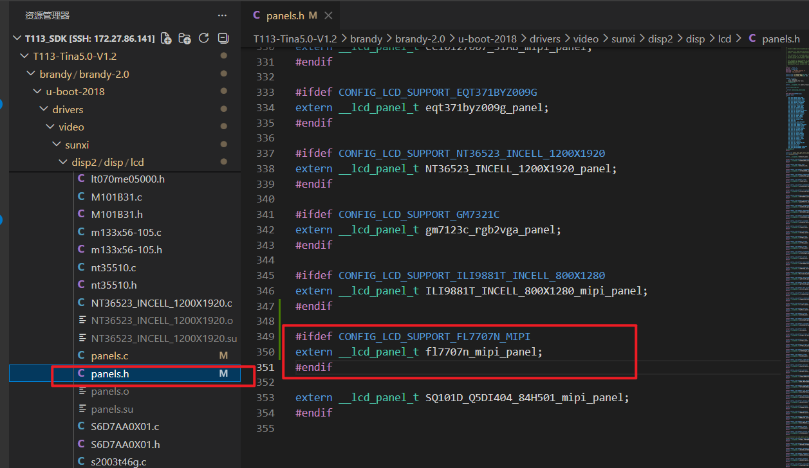

修改panels.h：

* 添加 panel 注册

```shell
vi <sdk>/brandy/brandy-2.0/u-boot-2018/drivers/video/sunxi/disp2/disp/lcd/panels.c
```

修改内容：

```c
#ifdef CONFIG_LCD_SUPPORT_FL7707N_MIPI
		&fl7707n_mipi_panel,
#endif
```

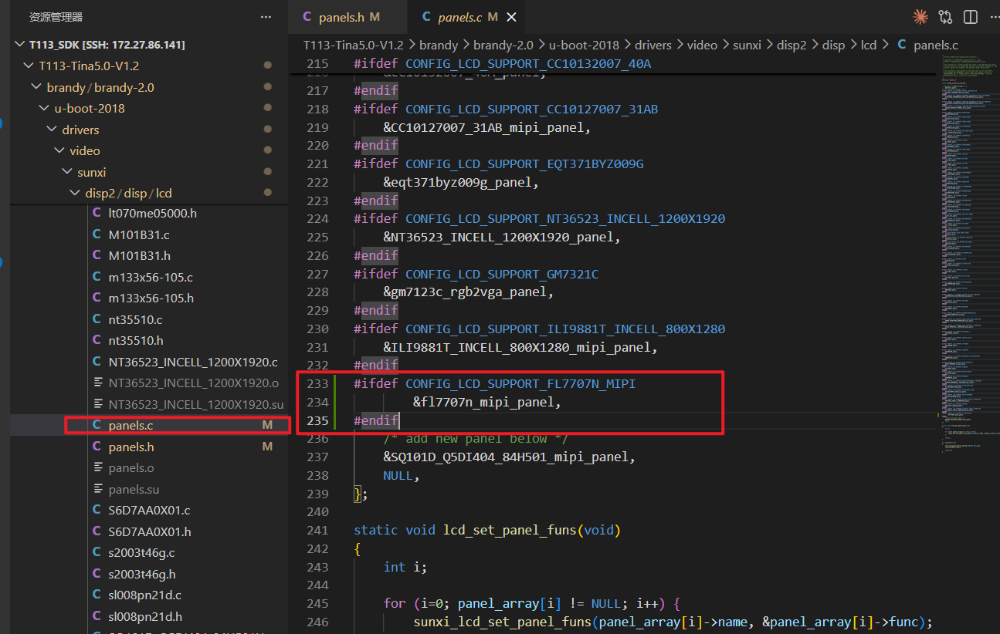

###### 修改 Makefile

修改 Makefile：

```shell
vi <sdk>/kernel/linux-5.4/drivers/video/fbdev/sunxi/disp2/disp/Makefile
```

修改内容：

```Makefile
disp-$(CONFIG_LCD_SUPPORT_B080UAN01_MIPI1200X1920) += lcd/b080uan01_mipi1200x1920.o
disp-$(CONFIG_LCD_SUPPORT_FL7707N_MIPI) += lcd/fl7707n_mipi.o    <-----------  添加  
disp-y += lcd/super_lcd_driver.o
```

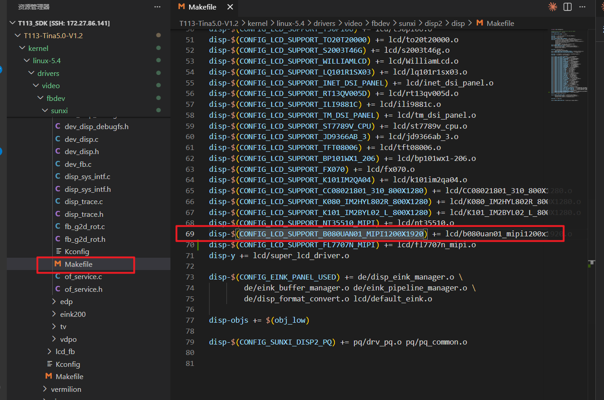

###### 修改 Kconfig

修改 Kconfig：

```shell
vi <sdk>/kernel/linux-5.4/drivers/video/fbdev/sunxi/disp2/disp/lcd/Kconfig
```

修改内容：

```shell
config LCD_SUPPORT_FL7707N_MIPI
	bool "LCD support fl7707n_mipi panel"
	default n
	help
		If you want to support fl7707n_mipi panel for display driver, select it.
```

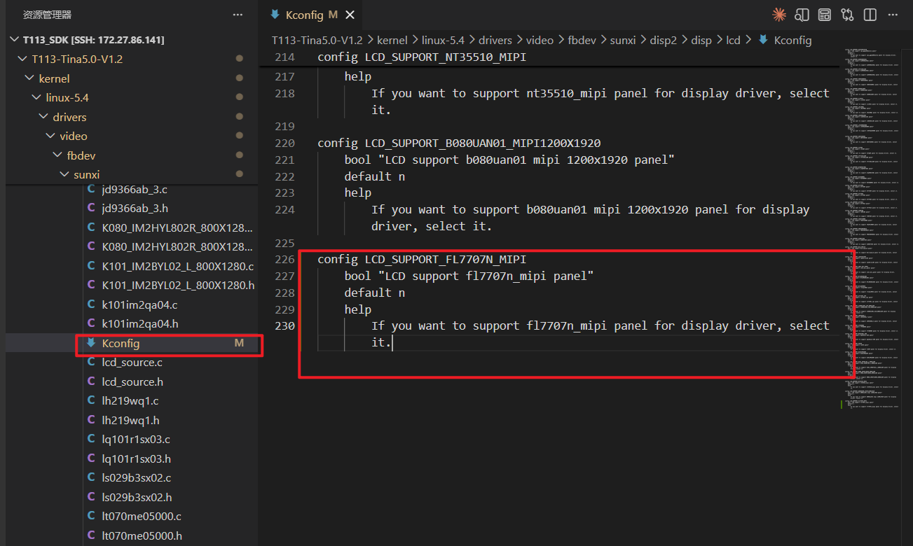

##### 内核 Menuconfig 配置

修改：

```shell
cd <sdk>/device/config/chips/t113/configs/zgl_board/linux-5.4/config-5.4
```

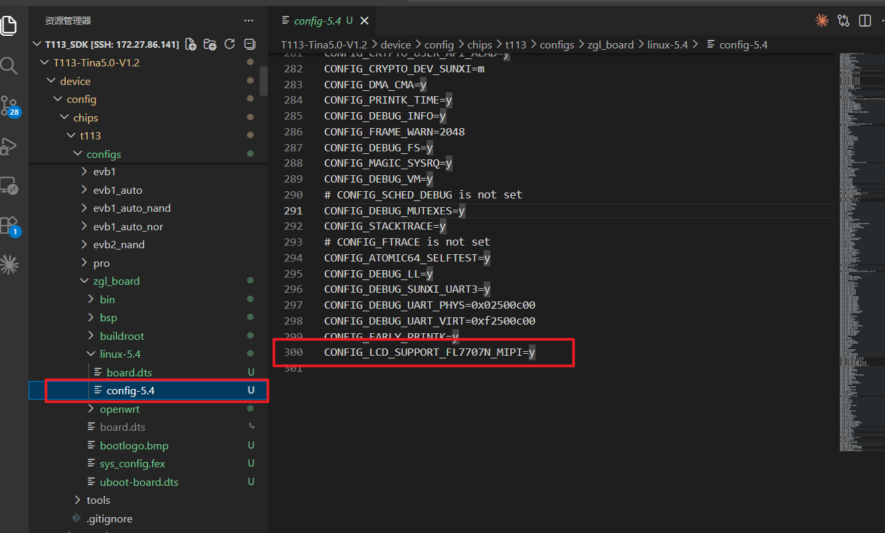

##### 内核设备树配置

修改设备树：

```shell
vi <sdk>/device/config/chips/t113/configs/zgl_board/board.dts
```

disp (显示控制器) 参数：

```dts
&disp {
    disp_init_enable         = <1>;
    disp_mode                = <0>;

    screen0_output_type      = <1>;    // LCD
    screen0_output_mode      = <4>;    // 1080p 时序模式

    screen1_output_type      = <3>;    // HDMI/TV
    screen1_output_mode      = <4>;

    dev0_output_type         = <1>;    // LCD
    dev0_output_mode         = <4>;
    dev0_screen_id           = <0>;
    dev0_do_hpd              = <0>;

    def_output_dev           = <0>;
    disp_rotation_used       = <1>;
    degree0                  = <0>;

    fb0_format               = <0>;   // ARGB8888
    fb0_buffer_num           = <2>;   // 双缓冲
    fb0_width                = <280>; // 帧缓冲宽度
    fb0_height               = <1424>;// 帧缓冲高度

    chn_cfg_mode             = <1>;   // 双显示：主显示4通道，副显示2通道
};
```

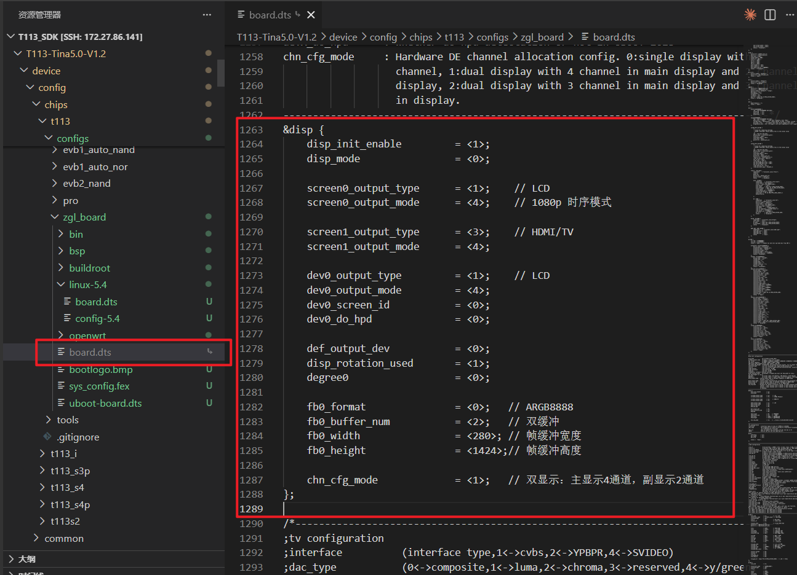

lcd0 (LCD 面板) 参数：

```dts
&lcd0 {
    lcd_used            = <1>;          // 启用 LCD
    lcd_driver_name     = "fl7707n_mipi"; // 驱动名称
    lcd_backlight       = <50>;
    lcd_if              = <4>;          // DSI 接口
    lcd_dsi_if          = <0>;          // video mode

    lcd_dsi_lane        = <4>;          // 4-lane MIPI DSI
    pinctrl-0 = <&dsi4lane_pins_a>;
    pinctrl-1 = <&dsi4lane_pins_b>;

    lcd_x               = <280>;        // 水平像素
    lcd_y               = <1424>;       // 垂直像素
    lcd_width           = <72>;         // 物理宽度 (mm)
    lcd_height          = <171>;        // 物理高度 (mm)
    lcd_dclk_freq       = <63>;         // DCLK 频率 (MHz)

    lcd_hbp             = <90>;         // HBP + HSPW
    lcd_ht              = <850>;        // 水平总周期
    lcd_hspw            = <30>;         // 行同步脉宽
    lcd_vbp             = <18>;         // VBP + VSPW
    lcd_vt              = <1457>;       // 垂直总周期
    lcd_vspw            = <3>;          // 场同步脉宽

    lcd_pwm_used        = <1>;          // 启用背光 PWM
    lcd_pwm_ch          = <7>;          // PWM 通道 7 (PD22)
    lcd_pwm_freq        = <10000>;      // PWM 频率 (Hz)
    lcd_pwm_pol         = <0>;          // 极性：正极
    lcd_pwm_max_limit   = <255>;

    lcd_dsi_format      = <0>;
    lcd_dsi_te          = <0>;
    lcd_frm             = <0>;
    lcd_gamma_en        = <0>;
    lcd_cmap_en         = <0>;

    lcd_gpio_0 = <&pio PD 20 GPIO_ACTIVE_HIGH>;  // LCD 复位引脚
};
```

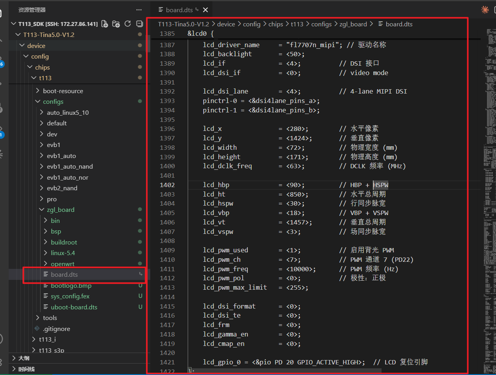

#### 重新编译打包

修改了 board.dts 和 uboot-board.dts：

```shell
./build.sh uboot
./build.sh kerner
./build.sh pack
./build.sh uboot && ./build.sh kernel && ./build.sh pack
```

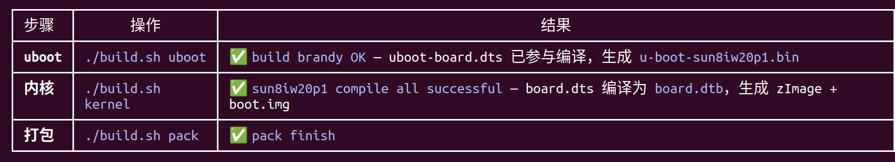

#### 测试

开发板上电后，检查 framebuffer 设备：

```shell
ls -l /dev/fb0
```

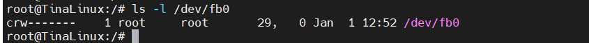

检查显示的状态信息：

```shell
# 检查 disp 状态（全志特有）
cat /sys/class/disp/disp/attr/sys
```

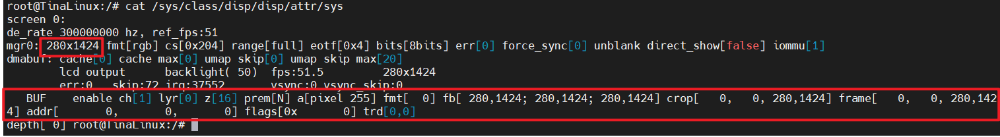

#####  花屏测试

~~~shell
cat /dev/urandom > /dev/fb0
~~~

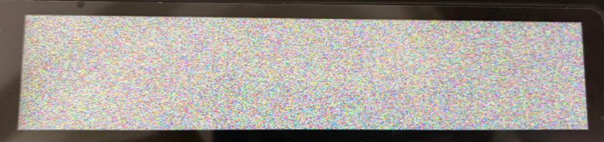

##### 彩条测试

```shell
cat /dev/zero > /dev/fb0
echo 8 > /sys/class/disp/disp/attr/colorbar

# 1. 先禁用 LCD
echo 'lcd0' > /sys/kernel/debug/dispdbg/name
echo 'disable' > /sys/kernel/debug/dispdbg/command
echo 1 > /sys/kernel/debug/dispdbg/start

# 2. 等 1 秒，再重新启用 LCD（重新配置 DSI，清掉 boot 时的错误）
echo 'lcd0' > /sys/kernel/debug/dispdbg/name
echo 'enable' > /sys/kernel/debug/dispdbg/command
echo 1 > /sys/kernel/debug/dispdbg/start

# 3. 触发彩条（4 条红/绿/蓝/黄竖条）
echo 8 > /sys/class/disp/disp/attr/colorbar

```


### 背光

原理图：

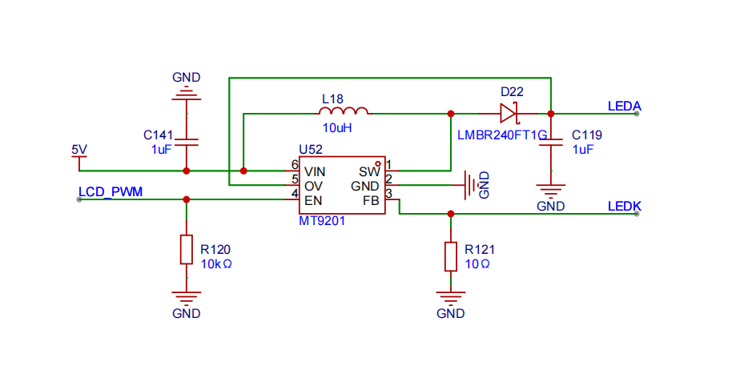

背光使用 **PWM7**（引脚 PD22），通过标准 `pwm-backlight` 驱动控制：

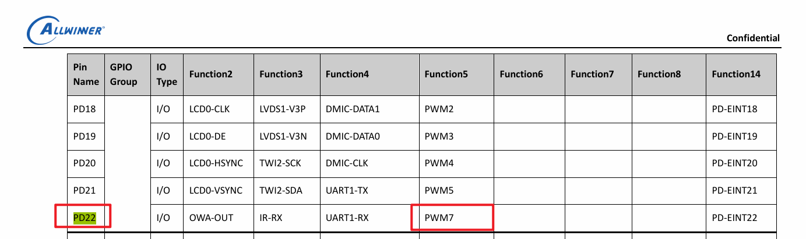

#### 修改设备树

 PWM 控制器在 SoC DTSI 已定义，默认不用修改：

**文件：** `kernel/linux-5.4/arch/arm/boot/dts/sun8iw20p1.dtsi`

```dts
pwm: pwm@2000c00 {
    #pwm-cells = <0x3>;
    compatible = "allwinner,sunxi-pwm";
    reg = <0x0 0x02000c00 0x0 0x400>;
    clocks = <&ccu CLK_BUS_PWM>;
    resets = <&ccu RST_BUS_PWM>;
    pwm-number = <8>;
    pwm-base = <0x0>;
    sunxi-pwms = <&pwm0>, <&pwm1>, <&pwm2>, <&pwm3>,
                 <&pwm4>, <&pwm5>, <&pwm6>, <&pwm7>;
};

pwm7: pwm7@2000c17 {
    compatible = "allwinner,sunxi-pwm7";
    pinctrl-names = "active", "sleep";
    reg = <0x0 0x02000c17 0x0 0x4>;
    reg_base = <0x02000c00>;
};
```

PWM7 引脚复用在设备树文件已经定义，默认不用修改：

```dts
pwm7_pin_a: pwm7@0 {
    pins = "PD22";
    function = "pwm7";
    drive-strength = <10>;
    bias-pull-up;
};

pwm7_pin_b: pwm7@1 {
    pins = "PD22";
    function = "gpio_in";
};
```

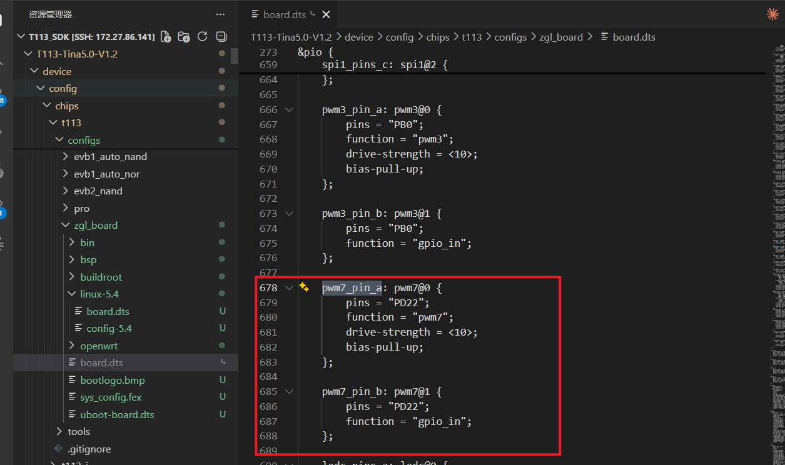

PWM7 使能在设备树文件已经定义，默认不用修改：

```dts
&pwm7 {
    pinctrl-names = "active", "sleep";
    pinctrl-0 = <&pwm7_pin_a>;
    pinctrl-1 = <&pwm7_pin_b>;
    status = "okay";
};
```

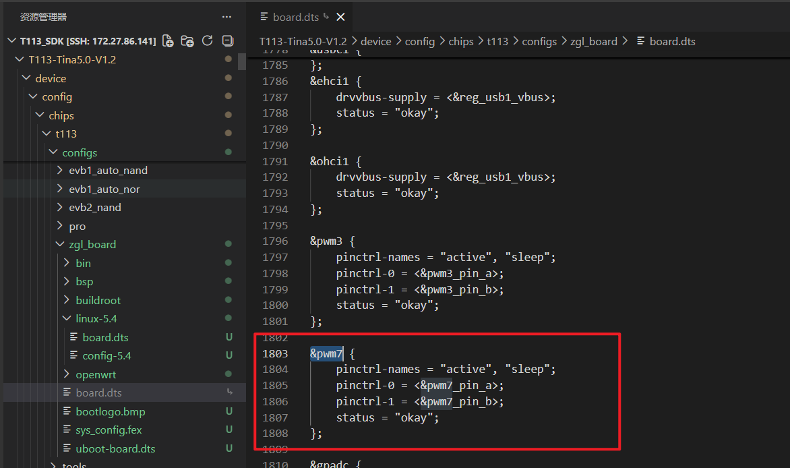

添加背光节点：

~~~shell
vi <sdk_dir>/device/config/chips/t113/configs/zgl_board/board.dts
~~~

添加内容：

```dts
/{
	backlight: backlight {
		compatible = "pwm-backlight";
		pwms = <&pwm 7 10000 0>;
		pwm-names = "backlight";
		brightness-levels = <
			0   1   2   3   4   5   6   7
			8   9  10  11  12  13  14  15
			16  17  18  19  20  21  22  23
			24  25  26  27  28  29  30  31
			32  33  34  35  36  37  38  39
			40  41  42  43  44  45  46  47
			48  49  50  51  52  53  54  55
			56  57  58  59  60  61  62  63
			64  65  66  67  68  69  70  71
			72  73  74  75  76  77  78  79
			80  81  82  83  84  85  86  87
			88  89  90  91  92  93  94  95
			96  97  98  99 100 101 102 103
			104 105 106 107 108 109 110 111
			112 113 114 115 116 117 118 119
			120 121 122 123 124 125 126 127
			128 129 130 131 132 133 134 135
			136 137 138 139 140 141 142 143
			144 145 146 147 148 149 150 151
			152 153 154 155 156 157 158 159
			160 161 162 163 164 165 166 167
			168 169 170 171 172 173 174 175
			176 177 178 179 180 181 182 183
			184 185 186 187 188 189 190 191
			192 193 194 195 196 197 198 199
			200 201 202 203 204 205 206 207
			208 209 210 211 212 213 214 215
			216 217 218 219 220 221 222 223
			224 225 226 227 228 229 230 231
			232 233 234 235 236 237 238 239
			240 241 242 243 244 245 246 247
			248 249 250 251 252 253 254 255
		>;
		default-brightness-level = <100>;
		status = "okay";
	};
}
```

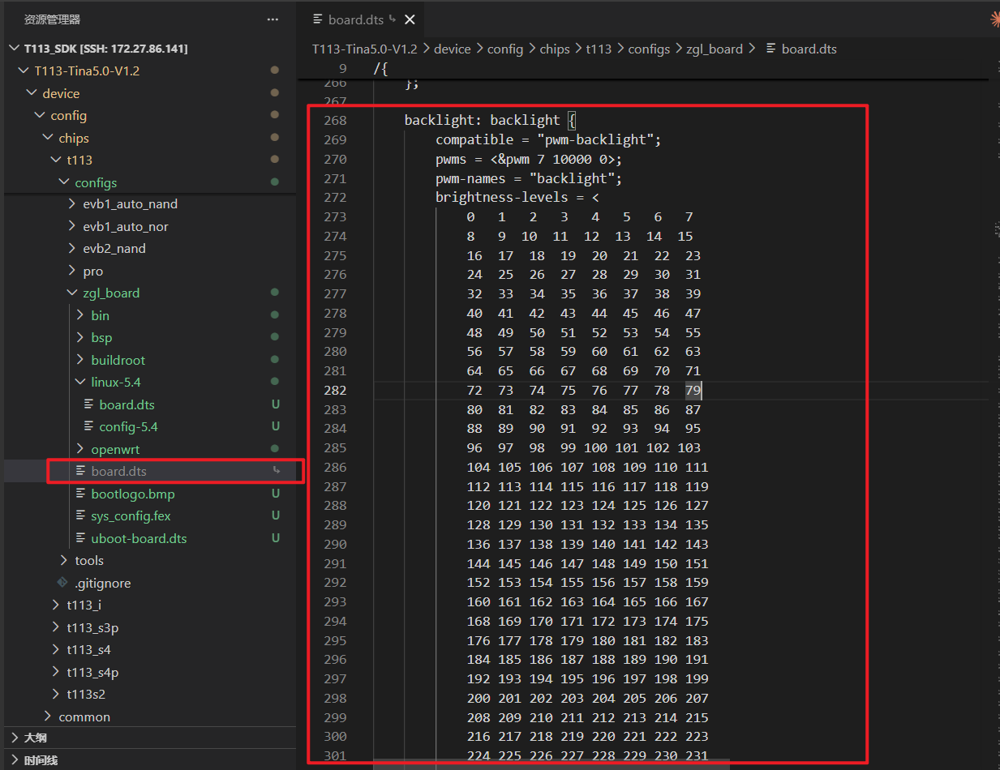

#### 内核 Menuconfig 配置

修改 config-5.4：

```shell
cd <sdk>/device/config/chips/t113/configs/evb1/linux-5.4/config-5.4
```

修改内容：

```shell
CONFIG_BACKLIGHT_CLASS_DEVICE=y  // 背光类设备支持
CONFIG_BACKLIGHT_PWM=y           //  pwm-backlight 驱动
CONFIG_BACKLIGHT_GPIO=y
```

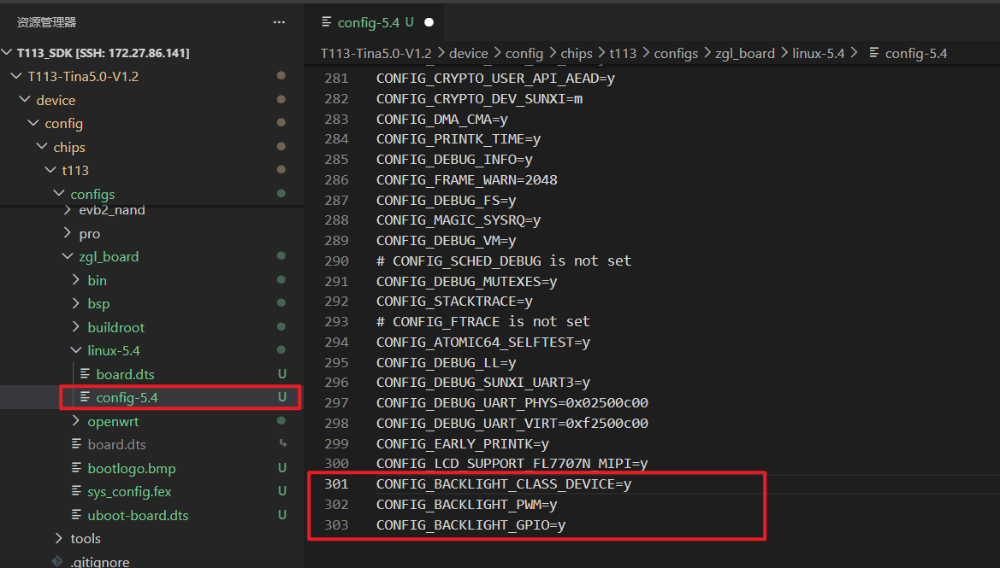

#### 重新编译打包

修改完成后重新编译：

```shell
./build.sh kernel && ./build.sh pack
```

#### 测试

系统启动后，应出现 `/sys/class/backlight/backlight/` 目录：

```bash
# 检查 PWM7 是否正确配置
cat /sys/kernel/debug/pwm

# 查看当前亮度
cat /sys/class/backlight/backlight/brightness

# 设置亮度（0-255）
echo 150 > /sys/class/backlight/backlight/brightness  // 屏幕可看到亮度变化

# 查看最大亮度
cat /sys/class/backlight/backlight/max_brightness

# 查看实际亮度值
cat /sys/class/backlight/backlight/actual_brightness
```

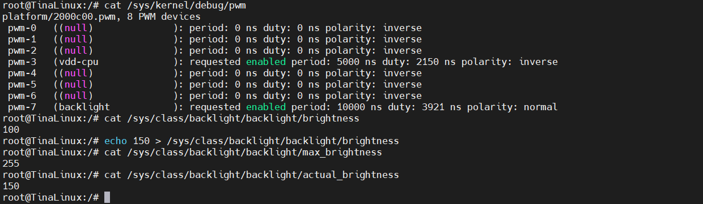

### 触摸

原理图：

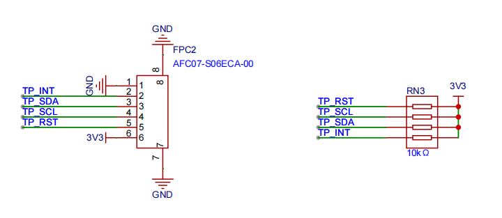

引脚：

| 触摸信号 | 引脚 | 功能                 |
| -------- | ---- | -------------------- |
| TP_INT   | PE5  | 触摸中断，下降沿触发 |
| TP_SDA   | PE1  | TWI1 数据线          |
| TP_SCL   | PE0  | TWI1 时钟线          |
| TP_RST   | PE4  | 触摸复位，高电平有效 |

触摸芯片地址：0x14 或者 0x5d（GT9XX 系列 auto-detect: 0x14 / 0x5d）

数据手册：

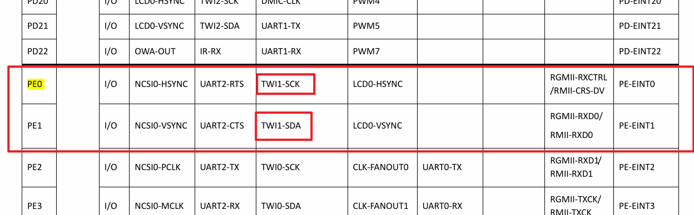

#### 修改设备树

修改设备树：

```shell
vi <sdk>/device/config/chips/t113/configs/zgl_board/board.dts
```

修改内容：

* 删除 TWI0 的触摸节点，添加TWI1 控制器和触摸节点

```dts
&twi0 {
	clock-frequency = <400000>;
	pinctrl-0 = <&twi0_pins_a>;
	pinctrl-1 = <&twi0_pins_b>;
	pinctrl-names = "default", "sleep";
	twi_drv_used = <0>;
	dmas = <&dma 43>, <&dma 43>;
	dma-names = "tx", "rx";
	status = "disabled";
};

&twi1 {
    clock-frequency = <400000>;
    pinctrl-0 = <&twi1_pins_a>;    // PE0(SCK), PE1(SDA)
    pinctrl-1 = <&twi1_pins_b>;
    pinctrl-names = "default", "sleep";
    status = "okay";

    ctp@14 {
        compatible = "allwinner,goodix";
        device_type = "ctp";
        reg = <0x14>;
        status = "okay";
        ctp_name = "gt9xxnew_ts";
        ctp_twi_id = <0x1>;
        ctp_twi_addr = <0x14>;
        ctp_screen_max_x = <280>;    // 匹配 LCD 分辨率
        ctp_screen_max_y = <1424>;   // 匹配 LCD 分辨率
        ctp_revert_x_flag = <0x0>;
        ctp_revert_y_flag = <0x0>;
        ctp_exchange_x_y_flag = <0x0>;
        ctp_int_port = <&pio PE 5 GPIO_ACTIVE_HIGH>;   // TP_INT
        ctp_wakeup = <&pio PE 4 GPIO_ACTIVE_HIGH>;      // TP_RST
    };
};
```

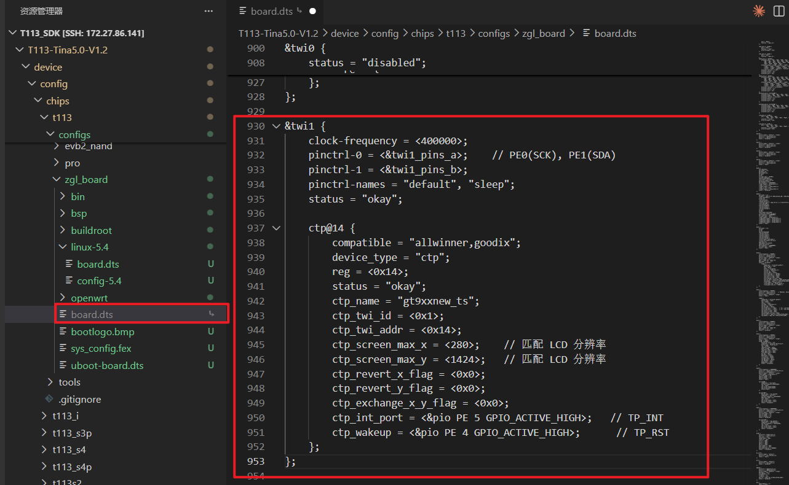

* TWI1 引脚复用定义

```dts
	twi1_pins_a: twi1@0 {
		pins = "PE0", "PE1";
		function = "twi1";
		drive-strength = <10>;
	};

	twi1_pins_b: twi1@1 {
		pins = "PE0", "PE1";
		function = "gpio_in";
	};
```


#### 重新编译打包

```shell
./build.sh kernel && ./build.sh pack
```

#### 测试

查看是否有设备：

```shell
ls /dev/i2c-*
cat /sys/bus/i2c/devices/*/name
```


查看输入设备，可以发现为 event4：

```shell
root@TinaLinux:/# cat /proc/bus/input/devices
I: Bus=0019 Vendor=0001 Product=0001 Version=0100
N: Name="sunxi-keyboard"
P: Phys=sunxikbd/input0
S: Sysfs=/devices/virtual/input/input0
U: Uniq=
H: Handlers=kbd event0
B: PROP=0
B: EV=3
B: KEY=1000 800 c0000 0 0 10000000

I: Bus=0019 Vendor=0001 Product=0001 Version=0100
N: Name="sunxi-ts"
P: Phys=sunxi_ts/input0
S: Sysfs=/devices/platform/soc@3000000/2009c00.rtp/input/input1
U: Uniq=
H: Handlers=event1
B: PROP=0
B: EV=b
B: KEY=400 0 0 0 0 0 0 0 0 0 0
B: ABS=3

I: Bus=0019 Vendor=0001 Product=0001 Version=0100
N: Name="sunxi-gpadc0"
P: Phys=sunxigpadc0/input0
S: Sysfs=/devices/virtual/input/input2
U: Uniq=
H: Handlers=kbd event2
B: PROP=0
B: EV=100003
B: KEY=200000 0 0 0 0 0 0 0 8c0000 0 0 10000000

I: Bus=0019 Vendor=0001 Product=0001 Version=0100
N: Name="sunxi-ir"
P: Phys=sunxi-ir/input0
S: Sysfs=/devices/platform/soc@3000000/7040000.s_cir/rc/rc0/s_cir_rx
U: Uniq=
H: Handlers=kbd event3
B: PROP=20
B: EV=100017
B: KEY=2
B: REL=3
B: MSC=10

I: Bus=0018 Vendor=dead Product=beef Version=28bb
N: Name="gt9xxnew_ts"
P: Phys=
S: Sysfs=/devices/virtual/input/input4
U: Uniq=
H: Handlers=kbd event4
B: PROP=2
B: EV=b
B: KEY=400 0 0 7f8 0 0 0 100000 0 0 0
B: ABS=2650000 0

I: Bus=0000 Vendor=0000 Product=0000 Version=0000
N: Name="audiocodec Headphones"
P: Phys=ALSA
S: Sysfs=/devices/platform/soc@3000000/soc@3000000:codec_mach/sound/card0/input5
U: Uniq=
H: Handlers=kbd event5
B: PROP=0
B: EV=23
B: KEY=40 0 0 0 0 0 0 0 0 0 0 4 0 0 0 c0000 0 0 0
B: SW=14
```


触摸测试：

```shell
hexdump /dev/input/event4
```


### lvgl

测试

~~~shell
adb push lv_examples /data/lv_examples
adb shell chmod +x /data/lv_examples
~~~


```bash
# 运行 Widgets Demo（默认）
lv_demo

# 或指定 demo 编号
lv_demo 0    # Widgets Demo
lv_demo 1    # Benchmark Demo  
lv_demo 2    # Stress Demo
lv_demo 3    # Keypad Encoder Demo
lv_demo 4    # Music Demo (需要 LV_USE_DEMO_MUSIC=1 编译)

# 退出（Ctrl+C）
```


### 音频

板载咪头使用差分信号 MICIN3P/3N 输入：


板载扬声器接口使用单端信号 HPOUTR 输出：


#### 修改设备树

修改设备树：

```shell
vi <sdk>/device/config/chips/t113/configs/zgl_board/board.dts
```

修改内容：

```dts
&codec {
    /* avcc-external; */
    tx-hub-en;
    rx-sync-en;

    dac-vol     = <63>;     /* 默认值 63，范围 0-63 */
    dacl-vol    = <160>;    /* 左声道 DAC 音量，范围 0-255 */
    dacr-vol    = <160>;    /* 右声道 DAC 音量 */
    adc1-vol    = <160>;    /* ADC1 录音音量 */
    adc2-vol    = <160>;    /* ADC2 录音音量 */
    adc3-vol    = <160>;    /* ADC3 录音音量（接麦克风） */
    lineout-vol = <31>;     /* 线路输出音量，范围 0-31 */
    adc1-gain   = <31>;     /* ADC1 增益 */
    adc2-gain   = <31>;     /* ADC2 增益 */
    adc3-gain   = <31>;     /* ADC3 增益（接麦克风） */
    hpout-gain  = <7>;      /* 耳机输出增益，范围 0-7 */
    fminl-gain  = <0>;
    fminr-gain  = <0>;
    lineinl-gain = <0>;
    lineinr-gain = <0>;

    status = "okay";
};

&codec_plat {
    status = "okay";
};

&codec_mach {
    soundcard-mach,jack-support = <1>;
    status = "okay";
    soundcard-mach,cpu {
        sound-dai = <&codec_plat>;
    };
    soundcard-mach,codec {
        sound-dai = <&codec>;
    };
};
```


#### 重新编译打包

```shell
./build.sh kernel && ./build.sh pack
```

#### 测试

查看声卡设备：

```shell
aplay -l
```


查看属性设置：

```shell
amixer contents -c 0
```

参数设置：

```shell
# 关闭所有输入
amixer -c 0 cset numid=31 off    # MIC1
amixer -c 0 cset numid=32 off    # MIC2
amixer -c 0 cset numid=36 off    # LINEINL
amixer -c 0 cset numid=37 off    # LINEINR
amixer -c 0 cset numid=34 off    # FMINL
amixer -c 0 cset numid=35 off    # FMINR

# 关闭所有输出
amixer -c 0 cset numid=38 off    # LINEOUTL
amixer -c 0 cset numid=39 off    # LINEOUTR
amixer -c 0 cset numid=41 off    # SPK

# 设置MIC3输入通路
amixer -c 0 cset numid=33 on     # MIC3 Switch
amixer -c 0 cset numid=15 0      # MIC3单端输入
amixer -c 0 cset numid=44 0      # Input3 Mux = MIC3
amixer -c 0 cset numid=24 20     # ADC3 Gain 
amixer -c 0 cset numid=21 160    # ADC3 Volume 

# 关闭其他ADC
amixer -c 0 cset numid=22 0      # ADC1 Gain最小
amixer -c 0 cset numid=23 0      # ADC2 Gain最小

# 设置HPOUT输出通路
amixer -c 0 cset numid=40 on     # HPOUT Switch
amixer -c 0 cset numid=26 7      # HPOUT Gain 
amixer -c 0 cset numid=16 58     # DAC Digital Volume 
amixer -c 0 cset numid=17 200    # DACL Volume
amixer -c 0 cset numid=18 200    # DACR Volume
```

录音测试：

```shell
arecord -D hw:0,0 -c 1 -f S16_LE -r 48000 -d 5 record.wav
```

播放录音测试：

```shell
aplay -D hw:0,0 record.wav
```


播放音乐测试（音乐手动上传到开发板再测试）：

```shell
aplay -D hw:0,0 music.wav
aplay -D hw:0,0 music_01.wav
```


#### 新测试

默认不修改，直接录音测：

```shell
1. 先设置麦克风（每次断电后要重设）

amixer -c 0 cset numid=6,name='ADC HPF0 Mode' On
amixer -c 0 cset numid=8,name='ADC HPF1 Mode' On
amixer -c 0 cset numid=24,name='ADC3 Gain' 31

2. 录音 5 秒（对着板子说话）

arecord -d 5 -r 16000 -f S16_LE /tmp/test.wav

▎ 注意：不要加 -D hw:audiocodec,0！必须用默认设备（不带 -D），才会采到 MIC3。加了就只有底噪。

3. 用板上喇叭放出来听

aplay /tmp/test.wav

能听到自己刚才说的话 = 麦克风+喇叭全链路通。

听不到播放时的排查

播放音量可能太低，把这两个拉高再放：

amixer -c 0 cset numid=45,name='Soft Volume Master' 220,220
amixer -c 0 cset numid=16,name='DAC Digital Volume' 63

再不行就查开关：

amixer -c 0 cget numid=40,name='HPOUT Switch'    # 应为 on
amixer -c 0 cget numid=41,name='SPK Switch'      # 如果接了喇叭外放，改 on 试试：
amixer -c 0 cset numid=41,name='SPK Switch' on
```


### 蓝牙

原理图：


| MCU引脚 | 网络名    | 外设功能              | 输入/输出 | 默认状态          | 驱动方式       | 软件配置建议                   |
| ------- | --------- | --------------------- | --------- | ----------------- | -------------- | ------------------------------ |
| PG6     | UART1_TX  | RTL8723DS BT UART_IN  | 输出      | 上电悬空/模块输入 | UART1 TX 复用  | 配置 UART1，3.3V，配合硬件流控 |
| PG7     | UART1_RX  | RTL8723DS BT UART_OUT | 输入      | 模块输出决定      | UART1 RX 复用  | 配置 UART1 RX                  |
| PG8     | UART1_RTS | RTL8723DS UART_CTS    | 输出      | 悬空/模块输入     | UART1 RTS 复用 | 启用 RTS/CTS 硬件流控          |
| PG9     | UART1_CTS | RTL8723DS UART_RTS    | 输入      | 模块输出决定      | UART1 CTS 复用 | 启用 CTS 输入                  |

修改设备树：

```shell
&uart1 {
    pinctrl-names = "default", "sleep";
    pinctrl-0 = <&uart1_pins_a>;
    pinctrl-1 = <&uart1_pins_b>;
    status = "okay";

    bluetooth {
        compatible = "realtek,rtl8723ds-bt";
    };
};

rfkill: rfkill@0 {
    compatible    = "allwinner,sunxi-rfkill";
    chip_en       = <&pio PE 3 GPIO_ACTIVE_HIGH>;
    power_en;
    pinctrl-0 = <&wlan_pins_a>;
    pinctrl-names = "default";
    status        = "okay";

    wlan: wlan@0 {
        compatible    = "allwinner,sunxi-wlan";
        clock-names = "32k-fanout1";
        clocks = <&ccu CLK_FANOUT1_OUT>;
        wlan_busnum    = <0x1>;
        wakeup-source;
        wlan_hostwake = <&pio PG 10 GPIO_ACTIVE_HIGH>;
    };

    bt: bt@0 {
        compatible    = "allwinner,sunxi-bt";   // 匹配全志平台蓝牙驱动
        pinctrl-0 = <&wlan_pins_a>;             // 共享Wi-Fi的引脚组（如复位、使能引脚）
        pinctrl-names = "default";              // 引脚配置名称：默认模式
        clock-names = "32k-fanout1";            // 时钟名称：32kHz扇出时钟1
        clocks = <&ccu CLK_FANOUT1_OUT>;        // 引用32kHz时钟（蓝牙模块的基础时钟）
        status        = "okay";                 // 启用蓝牙模块
	};
};
```

测试：

```shell
# 1. BT 上电（同时为模块供电和 serdev 探测）
echo 1 > /sys/class/rfkill/rfkill0/state
dmesg | tail -10
sleep 2
dmesg | grep DBG
dmesg | grep '!!!DBG'
# 2. 检查 GPIO 状态
cat /sys/kernel/debug/gpio | grep chip_en
# 预期: gpio-131 (chip_en) out hi

# 3. 检查蓝牙设备
hciconfig -a
# 预期:
# hci0: Type: Primary  Bus: UART
#       BD Address: 5C:8E:8B:E8:A9:98  ACL MTU: 1021:8
#       UP RUNNING

# 4. 查看内核 BT 日志
dmesg | grep -i bluetooth
dmesg | grep -iE 'hci|bluetooth|h5|rtl'
dmesg | grep -iE 'hci|bluetooth|h5|rtl|serdev'
# 预期包含:
# Bluetooth: hci0: RTL: loading rtl_bt/rtl8723ds_fw.bin
# Bluetooth: hci0: RTL: firmware loaded

# 5. 蓝牙扫描
hciconfig hci0 up
```

驱动代码：hcih5.c

```c
// SPDX-License-Identifier: GPL-2.0-or-later
/*
 *
 *  Bluetooth HCI Three-wire UART driver
 *
 *  Copyright (C) 2012  Intel Corporation
 */

#include <linux/acpi.h>
#include <linux/of_device.h>
#include <linux/errno.h>
#include <linux/gpio/consumer.h>
#include <linux/kernel.h>
#include <linux/mod_devicetable.h>
#include <linux/serdev.h>
#include <linux/skbuff.h>

#include <net/bluetooth/bluetooth.h>
#include <net/bluetooth/hci_core.h>

#include "btrtl.h"
#include "hci_uart.h"

#define HCI_3WIRE_ACK_PKT	0
#define HCI_3WIRE_LINK_PKT	15

/* Sliding window size */
#define H5_TX_WIN_MAX		4

#define H5_ACK_TIMEOUT	msecs_to_jiffies(250)
#define H5_SYNC_TIMEOUT	msecs_to_jiffies(100)

/*
 * Maximum Three-wire packet:
 *     4 byte header + max value for 12-bit length + 2 bytes for CRC
 */
#define H5_MAX_LEN (4 + 0xfff + 2)

/* Convenience macros for reading Three-wire header values */
#define H5_HDR_SEQ(hdr)		((hdr)[0] & 0x07)
#define H5_HDR_ACK(hdr)		(((hdr)[0] >> 3) & 0x07)
#define H5_HDR_CRC(hdr)		(((hdr)[0] >> 6) & 0x01)
#define H5_HDR_RELIABLE(hdr)	(((hdr)[0] >> 7) & 0x01)
#define H5_HDR_PKT_TYPE(hdr)	((hdr)[1] & 0x0f)
#define H5_HDR_LEN(hdr)		((((hdr)[1] >> 4) & 0x0f) + ((hdr)[2] << 4))

#define SLIP_DELIMITER	0xc0
#define SLIP_ESC	0xdb
#define SLIP_ESC_DELIM	0xdc
#define SLIP_ESC_ESC	0xdd

/* H5 state flags */
enum {
	H5_RX_ESC,	/* SLIP escape mode */
	H5_TX_ACK_REQ,	/* Pending ack to send */
};

struct h5 {
	/* Must be the first member, hci_serdev.c expects this. */
	struct hci_uart		serdev_hu;

	struct sk_buff_head	unack;		/* Unack'ed packets queue */
	struct sk_buff_head	rel;		/* Reliable packets queue */
	struct sk_buff_head	unrel;		/* Unreliable packets queue */

	unsigned long		flags;

	struct sk_buff		*rx_skb;	/* Receive buffer */
	size_t			rx_pending;	/* Expecting more bytes */
	u8			rx_ack;		/* Last ack number received */

	int			(*rx_func)(struct hci_uart *hu, u8 c);

	struct timer_list	timer;		/* Retransmission timer */
	struct hci_uart		*hu;		/* Parent HCI UART */

	u8			tx_seq;		/* Next seq number to send */
	u8			tx_ack;		/* Next ack number to send */
	u8			tx_win;		/* Sliding window size */

	enum {
		H5_UNINITIALIZED,
		H5_INITIALIZED,
		H5_ACTIVE,
	} state;

	enum {
		H5_AWAKE,
		H5_SLEEPING,
		H5_WAKING_UP,
	} sleep;

	const struct h5_vnd *vnd;
	const char *id;

	struct gpio_desc *enable_gpio;
	struct gpio_desc *device_wake_gpio;
};

struct h5_vnd {
	int (*setup)(struct h5 *h5);
	void (*open)(struct h5 *h5);
	void (*close)(struct h5 *h5);
	int (*suspend)(struct h5 *h5);
	int (*resume)(struct h5 *h5);
	const struct acpi_gpio_mapping *acpi_gpio_map;
};

static void h5_reset_rx(struct h5 *h5);

static void h5_link_control(struct hci_uart *hu, const void *data, size_t len)
{
	struct h5 *h5 = hu->priv;
	struct sk_buff *nskb;

	nskb = alloc_skb(3, GFP_ATOMIC);
	if (!nskb)
		return;

	hci_skb_pkt_type(nskb) = HCI_3WIRE_LINK_PKT;

	skb_put_data(nskb, data, len);

	skb_queue_tail(&h5->unrel, nskb);
}

static u8 h5_cfg_field(struct h5 *h5)
{
	/* Sliding window size (first 3 bits) */
	return h5->tx_win & 0x07;
}

static void h5_timed_event(struct timer_list *t)
{
	const unsigned char sync_req[] = { 0x01, 0x7e };
	unsigned char conf_req[3] = { 0x03, 0xfc };
	struct h5 *h5 = from_timer(h5, t, timer);
	struct hci_uart *hu = h5->hu;
	struct sk_buff *skb;
	unsigned long flags;

	BT_DBG("%s", hu->hdev->name);

	if (h5->state == H5_UNINITIALIZED)
		h5_link_control(hu, sync_req, sizeof(sync_req));

	if (h5->state == H5_INITIALIZED) {
		conf_req[2] = h5_cfg_field(h5);
		h5_link_control(hu, conf_req, sizeof(conf_req));
	}

	if (h5->state != H5_ACTIVE) {
		mod_timer(&h5->timer, jiffies + H5_SYNC_TIMEOUT);
		goto wakeup;
	}

	if (h5->sleep != H5_AWAKE) {
		h5->sleep = H5_SLEEPING;
		goto wakeup;
	}

	BT_DBG("hu %p retransmitting %u pkts", hu, h5->unack.qlen);

	spin_lock_irqsave_nested(&h5->unack.lock, flags, SINGLE_DEPTH_NESTING);

	while ((skb = __skb_dequeue_tail(&h5->unack)) != NULL) {
		h5->tx_seq = (h5->tx_seq - 1) & 0x07;
		skb_queue_head(&h5->rel, skb);
	}

	spin_unlock_irqrestore(&h5->unack.lock, flags);

wakeup:
	hci_uart_tx_wakeup(hu);
}

static void h5_peer_reset(struct hci_uart *hu)
{
	struct h5 *h5 = hu->priv;

	BT_ERR("Peer device has reset");

	h5->state = H5_UNINITIALIZED;

	del_timer(&h5->timer);

	skb_queue_purge(&h5->rel);
	skb_queue_purge(&h5->unrel);
	skb_queue_purge(&h5->unack);

	h5->tx_seq = 0;
	h5->tx_ack = 0;

	/* Send reset request to upper stack */
	hci_reset_dev(hu->hdev);
}

static int h5_open(struct hci_uart *hu)
{
	struct h5 *h5;
	const unsigned char sync[] = { 0x01, 0x7e };

	BT_DBG("hu %p", hu);

	if (hu->serdev) {
		h5 = serdev_device_get_drvdata(hu->serdev);
	} else {
		h5 = kzalloc(sizeof(*h5), GFP_KERNEL);
		if (!h5)
			return -ENOMEM;
	}

	hu->priv = h5;
	h5->hu = hu;

	skb_queue_head_init(&h5->unack);
	skb_queue_head_init(&h5->rel);
	skb_queue_head_init(&h5->unrel);

	h5_reset_rx(h5);

	timer_setup(&h5->timer, h5_timed_event, 0);

	h5->tx_win = H5_TX_WIN_MAX;

	if (h5->vnd && h5->vnd->open)
		h5->vnd->open(h5);

	set_bit(HCI_UART_INIT_PENDING, &hu->hdev_flags);

	/* Send initial sync request */
	h5_link_control(hu, sync, sizeof(sync));
	mod_timer(&h5->timer, jiffies + H5_SYNC_TIMEOUT);

	return 0;
}

static int h5_close(struct hci_uart *hu)
{
	struct h5 *h5 = hu->priv;

	del_timer_sync(&h5->timer);

	skb_queue_purge(&h5->unack);
	skb_queue_purge(&h5->rel);
	skb_queue_purge(&h5->unrel);

	if (h5->vnd && h5->vnd->close)
		h5->vnd->close(h5);

	if (!hu->serdev)
		kfree(h5);

	return 0;
}

static int h5_setup(struct hci_uart *hu)
{
	struct h5 *h5 = hu->priv;

	if (h5->vnd && h5->vnd->setup)
		return h5->vnd->setup(h5);

	return 0;
}

static void h5_pkt_cull(struct h5 *h5)
{
	struct sk_buff *skb, *tmp;
	unsigned long flags;
	int i, to_remove;
	u8 seq;

	spin_lock_irqsave(&h5->unack.lock, flags);

	to_remove = skb_queue_len(&h5->unack);
	if (to_remove == 0)
		goto unlock;

	seq = h5->tx_seq;

	while (to_remove > 0) {
		if (h5->rx_ack == seq)
			break;

		to_remove--;
		seq = (seq - 1) & 0x07;
	}

	if (seq != h5->rx_ack)
		BT_ERR("Controller acked invalid packet");

	i = 0;
	skb_queue_walk_safe(&h5->unack, skb, tmp) {
		if (i++ >= to_remove)
			break;

		__skb_unlink(skb, &h5->unack);
		kfree_skb(skb);
	}

	if (skb_queue_empty(&h5->unack))
		del_timer(&h5->timer);

unlock:
	spin_unlock_irqrestore(&h5->unack.lock, flags);
}

static void h5_handle_internal_rx(struct hci_uart *hu)
{
	struct h5 *h5 = hu->priv;
	const unsigned char sync_req[] = { 0x01, 0x7e };
	const unsigned char sync_rsp[] = { 0x02, 0x7d };
	unsigned char conf_req[3] = { 0x03, 0xfc };
	const unsigned char conf_rsp[] = { 0x04, 0x7b };
	const unsigned char wakeup_req[] = { 0x05, 0xfa };
	const unsigned char woken_req[] = { 0x06, 0xf9 };
	const unsigned char sleep_req[] = { 0x07, 0x78 };
	const unsigned char *hdr = h5->rx_skb->data;
	const unsigned char *data = &h5->rx_skb->data[4];

	BT_DBG("%s", hu->hdev->name);

	if (H5_HDR_PKT_TYPE(hdr) != HCI_3WIRE_LINK_PKT)
		return;

	if (H5_HDR_LEN(hdr) < 2)
		return;

	conf_req[2] = h5_cfg_field(h5);

	if (memcmp(data, sync_req, 2) == 0) {
		if (h5->state == H5_ACTIVE)
			h5_peer_reset(hu);
		h5_link_control(hu, sync_rsp, 2);
	} else if (memcmp(data, sync_rsp, 2) == 0) {
		if (h5->state == H5_ACTIVE)
			h5_peer_reset(hu);
		h5->state = H5_INITIALIZED;
		h5_link_control(hu, conf_req, 3);
	} else if (memcmp(data, conf_req, 2) == 0) {
		h5_link_control(hu, conf_rsp, 2);
		h5_link_control(hu, conf_req, 3);
	} else if (memcmp(data, conf_rsp, 2) == 0) {
		if (H5_HDR_LEN(hdr) > 2)
			h5->tx_win = (data[2] & 0x07);
		BT_DBG("Three-wire init complete. tx_win %u", h5->tx_win);
		h5->state = H5_ACTIVE;
		hci_uart_init_ready(hu);
		return;
	} else if (memcmp(data, sleep_req, 2) == 0) {
		BT_DBG("Peer went to sleep");
		h5->sleep = H5_SLEEPING;
		return;
	} else if (memcmp(data, woken_req, 2) == 0) {
		BT_DBG("Peer woke up");
		h5->sleep = H5_AWAKE;
	} else if (memcmp(data, wakeup_req, 2) == 0) {
		BT_DBG("Peer requested wakeup");
		h5_link_control(hu, woken_req, 2);
		h5->sleep = H5_AWAKE;
	} else {
		BT_DBG("Link Control: 0x%02hhx 0x%02hhx", data[0], data[1]);
		return;
	}

	hci_uart_tx_wakeup(hu);
}

static void h5_complete_rx_pkt(struct hci_uart *hu)
{
	struct h5 *h5 = hu->priv;
	const unsigned char *hdr = h5->rx_skb->data;

	if (H5_HDR_RELIABLE(hdr)) {
		h5->tx_ack = (h5->tx_ack + 1) % 8;
		set_bit(H5_TX_ACK_REQ, &h5->flags);
		hci_uart_tx_wakeup(hu);
	}

	h5->rx_ack = H5_HDR_ACK(hdr);

	h5_pkt_cull(h5);

	switch (H5_HDR_PKT_TYPE(hdr)) {
	case HCI_EVENT_PKT:
	case HCI_ACLDATA_PKT:
	case HCI_SCODATA_PKT:
		hci_skb_pkt_type(h5->rx_skb) = H5_HDR_PKT_TYPE(hdr);

		/* Remove Three-wire header */
		skb_pull(h5->rx_skb, 4);

		hci_recv_frame(hu->hdev, h5->rx_skb);
		h5->rx_skb = NULL;

		break;

	default:
		h5_handle_internal_rx(hu);
		break;
	}

	h5_reset_rx(h5);
}

static int h5_rx_crc(struct hci_uart *hu, unsigned char c)
{
	h5_complete_rx_pkt(hu);

	return 0;
}

static int h5_rx_payload(struct hci_uart *hu, unsigned char c)
{
	struct h5 *h5 = hu->priv;
	const unsigned char *hdr = h5->rx_skb->data;

	if (H5_HDR_CRC(hdr)) {
		h5->rx_func = h5_rx_crc;
		h5->rx_pending = 2;
	} else {
		h5_complete_rx_pkt(hu);
	}

	return 0;
}

static int h5_rx_3wire_hdr(struct hci_uart *hu, unsigned char c)
{
	struct h5 *h5 = hu->priv;
	const unsigned char *hdr = h5->rx_skb->data;

	BT_DBG("%s rx: seq %u ack %u crc %u rel %u type %u len %u",
	       hu->hdev->name, H5_HDR_SEQ(hdr), H5_HDR_ACK(hdr),
	       H5_HDR_CRC(hdr), H5_HDR_RELIABLE(hdr), H5_HDR_PKT_TYPE(hdr),
	       H5_HDR_LEN(hdr));

	if (((hdr[0] + hdr[1] + hdr[2] + hdr[3]) & 0xff) != 0xff) {
		BT_ERR("Invalid header checksum");
		h5_reset_rx(h5);
		return 0;
	}

	if (H5_HDR_RELIABLE(hdr) && H5_HDR_SEQ(hdr) != h5->tx_ack) {
		BT_ERR("Out-of-order packet arrived (%u != %u)",
		       H5_HDR_SEQ(hdr), h5->tx_ack);
		h5_reset_rx(h5);
		return 0;
	}

	if (h5->state != H5_ACTIVE &&
	    H5_HDR_PKT_TYPE(hdr) != HCI_3WIRE_LINK_PKT) {
		BT_ERR("Non-link packet received in non-active state");
		h5_reset_rx(h5);
		return 0;
	}

	h5->rx_func = h5_rx_payload;
	h5->rx_pending = H5_HDR_LEN(hdr);

	return 0;
}

static int h5_rx_pkt_start(struct hci_uart *hu, unsigned char c)
{
	struct h5 *h5 = hu->priv;

	if (c == SLIP_DELIMITER)
		return 1;

	h5->rx_func = h5_rx_3wire_hdr;
	h5->rx_pending = 4;

	h5->rx_skb = bt_skb_alloc(H5_MAX_LEN, GFP_ATOMIC);
	if (!h5->rx_skb) {
		BT_ERR("Can't allocate mem for new packet");
		h5_reset_rx(h5);
		return -ENOMEM;
	}

	h5->rx_skb->dev = (void *)hu->hdev;

	return 0;
}

static int h5_rx_delimiter(struct hci_uart *hu, unsigned char c)
{
	struct h5 *h5 = hu->priv;

	if (c == SLIP_DELIMITER)
		h5->rx_func = h5_rx_pkt_start;

	return 1;
}

static void h5_unslip_one_byte(struct h5 *h5, unsigned char c)
{
	const u8 delim = SLIP_DELIMITER, esc = SLIP_ESC;
	const u8 *byte = &c;

	if (!test_bit(H5_RX_ESC, &h5->flags) && c == SLIP_ESC) {
		set_bit(H5_RX_ESC, &h5->flags);
		return;
	}

	if (test_and_clear_bit(H5_RX_ESC, &h5->flags)) {
		switch (c) {
		case SLIP_ESC_DELIM:
			byte = &delim;
			break;
		case SLIP_ESC_ESC:
			byte = &esc;
			break;
		default:
			BT_ERR("Invalid esc byte 0x%02hhx", c);
			h5_reset_rx(h5);
			return;
		}
	}

	skb_put_data(h5->rx_skb, byte, 1);
	h5->rx_pending--;

	BT_DBG("unslipped 0x%02hhx, rx_pending %zu", *byte, h5->rx_pending);
}

static void h5_reset_rx(struct h5 *h5)
{
	if (h5->rx_skb) {
		kfree_skb(h5->rx_skb);
		h5->rx_skb = NULL;
	}

	h5->rx_func = h5_rx_delimiter;
	h5->rx_pending = 0;
	clear_bit(H5_RX_ESC, &h5->flags);
}

static int h5_recv(struct hci_uart *hu, const void *data, int count)
{
	struct h5 *h5 = hu->priv;
	const unsigned char *ptr = data;

	BT_DBG("%s pending %zu count %d", hu->hdev->name, h5->rx_pending,
	       count);

	while (count > 0) {
		int processed;

		if (h5->rx_pending > 0) {
			if (*ptr == SLIP_DELIMITER) {
				BT_ERR("Too short H5 packet");
				h5_reset_rx(h5);
				continue;
			}

			h5_unslip_one_byte(h5, *ptr);

			ptr++; count--;
			continue;
		}

		processed = h5->rx_func(hu, *ptr);
		if (processed < 0)
			return processed;

		ptr += processed;
		count -= processed;
	}

	return 0;
}

static int h5_enqueue(struct hci_uart *hu, struct sk_buff *skb)
{
	struct h5 *h5 = hu->priv;

	if (skb->len > 0xfff) {
		BT_ERR("Packet too long (%u bytes)", skb->len);
		kfree_skb(skb);
		return 0;
	}

	if (h5->state != H5_ACTIVE) {
		BT_ERR("Ignoring HCI data in non-active state");
		kfree_skb(skb);
		return 0;
	}

	switch (hci_skb_pkt_type(skb)) {
	case HCI_ACLDATA_PKT:
	case HCI_COMMAND_PKT:
		skb_queue_tail(&h5->rel, skb);
		break;

	case HCI_SCODATA_PKT:
		skb_queue_tail(&h5->unrel, skb);
		break;

	default:
		BT_ERR("Unknown packet type %u", hci_skb_pkt_type(skb));
		kfree_skb(skb);
		break;
	}

	return 0;
}

static void h5_slip_delim(struct sk_buff *skb)
{
	const char delim = SLIP_DELIMITER;

	skb_put_data(skb, &delim, 1);
}

static void h5_slip_one_byte(struct sk_buff *skb, u8 c)
{
	const char esc_delim[2] = { SLIP_ESC, SLIP_ESC_DELIM };
	const char esc_esc[2] = { SLIP_ESC, SLIP_ESC_ESC };

	switch (c) {
	case SLIP_DELIMITER:
		skb_put_data(skb, &esc_delim, 2);
		break;
	case SLIP_ESC:
		skb_put_data(skb, &esc_esc, 2);
		break;
	default:
		skb_put_data(skb, &c, 1);
	}
}

static bool valid_packet_type(u8 type)
{
	switch (type) {
	case HCI_ACLDATA_PKT:
	case HCI_COMMAND_PKT:
	case HCI_SCODATA_PKT:
	case HCI_3WIRE_LINK_PKT:
	case HCI_3WIRE_ACK_PKT:
		return true;
	default:
		return false;
	}
}

static struct sk_buff *h5_prepare_pkt(struct hci_uart *hu, u8 pkt_type,
				      const u8 *data, size_t len)
{
	struct h5 *h5 = hu->priv;
	struct sk_buff *nskb;
	u8 hdr[4];
	int i;

	if (!valid_packet_type(pkt_type)) {
		BT_ERR("Unknown packet type %u", pkt_type);
		return NULL;
	}

	/*
	 * Max len of packet: (original len + 4 (H5 hdr) + 2 (crc)) * 2
	 * (because bytes 0xc0 and 0xdb are escaped, worst case is when
	 * the packet is all made of 0xc0 and 0xdb) + 2 (0xc0
	 * delimiters at start and end).
	 */
	nskb = alloc_skb((len + 6) * 2 + 2, GFP_ATOMIC);
	if (!nskb)
		return NULL;

	hci_skb_pkt_type(nskb) = pkt_type;

	h5_slip_delim(nskb);

	hdr[0] = h5->tx_ack << 3;
	clear_bit(H5_TX_ACK_REQ, &h5->flags);

	/* Reliable packet? */
	if (pkt_type == HCI_ACLDATA_PKT || pkt_type == HCI_COMMAND_PKT) {
		hdr[0] |= 1 << 7;
		hdr[0] |= h5->tx_seq;
		h5->tx_seq = (h5->tx_seq + 1) % 8;
	}

	hdr[1] = pkt_type | ((len & 0x0f) << 4);
	hdr[2] = len >> 4;
	hdr[3] = ~((hdr[0] + hdr[1] + hdr[2]) & 0xff);

	BT_DBG("%s tx: seq %u ack %u crc %u rel %u type %u len %u",
	       hu->hdev->name, H5_HDR_SEQ(hdr), H5_HDR_ACK(hdr),
	       H5_HDR_CRC(hdr), H5_HDR_RELIABLE(hdr), H5_HDR_PKT_TYPE(hdr),
	       H5_HDR_LEN(hdr));

	for (i = 0; i < 4; i++)
		h5_slip_one_byte(nskb, hdr[i]);

	for (i = 0; i < len; i++)
		h5_slip_one_byte(nskb, data[i]);

	h5_slip_delim(nskb);

	return nskb;
}

static struct sk_buff *h5_dequeue(struct hci_uart *hu)
{
	struct h5 *h5 = hu->priv;
	unsigned long flags;
	struct sk_buff *skb, *nskb;

	if (h5->sleep != H5_AWAKE) {
		const unsigned char wakeup_req[] = { 0x05, 0xfa };

		if (h5->sleep == H5_WAKING_UP)
			return NULL;

		h5->sleep = H5_WAKING_UP;
		BT_DBG("Sending wakeup request");

		mod_timer(&h5->timer, jiffies + HZ / 100);
		return h5_prepare_pkt(hu, HCI_3WIRE_LINK_PKT, wakeup_req, 2);
	}

	skb = skb_dequeue(&h5->unrel);
	if (skb) {
		nskb = h5_prepare_pkt(hu, hci_skb_pkt_type(skb),
				      skb->data, skb->len);
		if (nskb) {
			kfree_skb(skb);
			return nskb;
		}

		skb_queue_head(&h5->unrel, skb);
		BT_ERR("Could not dequeue pkt because alloc_skb failed");
	}

	spin_lock_irqsave_nested(&h5->unack.lock, flags, SINGLE_DEPTH_NESTING);

	if (h5->unack.qlen >= h5->tx_win)
		goto unlock;

	skb = skb_dequeue(&h5->rel);
	if (skb) {
		nskb = h5_prepare_pkt(hu, hci_skb_pkt_type(skb),
				      skb->data, skb->len);
		if (nskb) {
			__skb_queue_tail(&h5->unack, skb);
			mod_timer(&h5->timer, jiffies + H5_ACK_TIMEOUT);
			spin_unlock_irqrestore(&h5->unack.lock, flags);
			return nskb;
		}

		skb_queue_head(&h5->rel, skb);
		BT_ERR("Could not dequeue pkt because alloc_skb failed");
	}

unlock:
	spin_unlock_irqrestore(&h5->unack.lock, flags);

	if (test_bit(H5_TX_ACK_REQ, &h5->flags))
		return h5_prepare_pkt(hu, HCI_3WIRE_ACK_PKT, NULL, 0);

	return NULL;
}

static int h5_flush(struct hci_uart *hu)
{
	BT_DBG("hu %p", hu);
	return 0;
}

static const struct hci_uart_proto h5p = {
	.id		= HCI_UART_3WIRE,
	.name		= "Three-wire (H5)",
	.open		= h5_open,
	.close		= h5_close,
	.setup		= h5_setup,
	.recv		= h5_recv,
	.enqueue	= h5_enqueue,
	.dequeue	= h5_dequeue,
	.flush		= h5_flush,
};

static int h5_serdev_probe(struct serdev_device *serdev)
{
	const struct acpi_device_id *match;
	struct device *dev = &serdev->dev;
	struct h5 *h5;

	h5 = devm_kzalloc(dev, sizeof(*h5), GFP_KERNEL);
	if (!h5)
		return -ENOMEM;

	set_bit(HCI_UART_RESET_ON_INIT, &h5->serdev_hu.hdev_flags);

	h5->hu = &h5->serdev_hu;
	h5->serdev_hu.serdev = serdev;
	serdev_device_set_drvdata(serdev, h5);

	if (has_acpi_companion(dev)) {
		match = acpi_match_device(dev->driver->acpi_match_table, dev);
		if (!match)
			return -ENODEV;

		h5->vnd = (const struct h5_vnd *)match->driver_data;
		h5->id  = (char *)match->id;

		if (h5->vnd->acpi_gpio_map)
			devm_acpi_dev_add_driver_gpios(dev,
						       h5->vnd->acpi_gpio_map);
	} else if (dev->of_node) {
		const struct of_device_id *of_match;
	
		of_match = of_match_device(dev->driver->of_match_table, dev);
		if (of_match && of_match->data)
			h5->vnd = (const struct h5_vnd *)of_match->data;

}

	h5->enable_gpio = devm_gpiod_get_optional(dev, "enable", GPIOD_OUT_LOW);
	if (IS_ERR(h5->enable_gpio))
		return PTR_ERR(h5->enable_gpio);

	h5->device_wake_gpio = devm_gpiod_get_optional(dev, "device-wake",
						       GPIOD_OUT_LOW);
	if (IS_ERR(h5->device_wake_gpio))
		return PTR_ERR(h5->device_wake_gpio);

	return hci_uart_register_device(&h5->serdev_hu, &h5p);
}

static void h5_serdev_remove(struct serdev_device *serdev)
{
	struct h5 *h5 = serdev_device_get_drvdata(serdev);

	hci_uart_unregister_device(&h5->serdev_hu);
}

static int __maybe_unused h5_serdev_suspend(struct device *dev)
{
	struct h5 *h5 = dev_get_drvdata(dev);
	int ret = 0;

	if (h5->vnd && h5->vnd->suspend)
		ret = h5->vnd->suspend(h5);

	return ret;
}

static int __maybe_unused h5_serdev_resume(struct device *dev)
{
	struct h5 *h5 = dev_get_drvdata(dev);
	int ret = 0;

	if (h5->vnd && h5->vnd->resume)
		ret = h5->vnd->resume(h5);

	return ret;
}

#ifdef CONFIG_BT_HCIUART_RTL
static int h5_btrtl_setup(struct h5 *h5)
{
	struct btrtl_device_info *btrtl_dev;
	struct sk_buff *skb;
	__le32 baudrate_data;
	u32 device_baudrate;
	unsigned int controller_baudrate;
	bool flow_control;
	int err;

	btrtl_dev = btrtl_initialize(h5->hu->hdev, h5->id);
	if (IS_ERR(btrtl_dev))
		return PTR_ERR(btrtl_dev);

	err = btrtl_get_uart_settings(h5->hu->hdev, btrtl_dev,
				      &controller_baudrate, &device_baudrate,
				      &flow_control);
	if (err)
		goto out_free;

	baudrate_data = cpu_to_le32(device_baudrate);
	skb = __hci_cmd_sync(h5->hu->hdev, 0xfc17, sizeof(baudrate_data),
			     &baudrate_data, HCI_INIT_TIMEOUT);
	if (IS_ERR(skb)) {
		rtl_dev_err(h5->hu->hdev, "set baud rate command failed\n");
		err = PTR_ERR(skb);
		goto out_free;
	} else {
		kfree_skb(skb);
	}
	/* Give the device some time to set up the new baudrate. */
	usleep_range(10000, 20000);

	serdev_device_set_baudrate(h5->hu->serdev, controller_baudrate);
	serdev_device_set_flow_control(h5->hu->serdev, flow_control);

	err = btrtl_download_firmware(h5->hu->hdev, btrtl_dev);
	/* Give the device some time before the hci-core sends it a reset */
	usleep_range(10000, 20000);

out_free:
	btrtl_free(btrtl_dev);

	return err;
}

static void h5_btrtl_open(struct h5 *h5)
{
	/* Devices always start with these fixed parameters */
	serdev_device_set_flow_control(h5->hu->serdev, false);
	serdev_device_set_parity(h5->hu->serdev, SERDEV_PARITY_EVEN);
	serdev_device_set_baudrate(h5->hu->serdev, 115200);

	/* The controller needs up to 500ms to wakeup */
	gpiod_set_value_cansleep(h5->enable_gpio, 1);
	gpiod_set_value_cansleep(h5->device_wake_gpio, 1);
	msleep(500);
}

static void h5_btrtl_close(struct h5 *h5)
{
	gpiod_set_value_cansleep(h5->device_wake_gpio, 0);
	gpiod_set_value_cansleep(h5->enable_gpio, 0);
}

/* Suspend/resume support. On many devices the RTL BT device loses power during
 * suspend/resume, causing it to lose its firmware and all state. So we simply
 * turn it off on suspend and reprobe on resume.  This mirrors how RTL devices
 * are handled in the USB driver, where the USB_QUIRK_RESET_RESUME is used which
 * also causes a reprobe on resume.
 */
static int h5_btrtl_suspend(struct h5 *h5)
{
	serdev_device_set_flow_control(h5->hu->serdev, false);
	gpiod_set_value_cansleep(h5->device_wake_gpio, 0);
	gpiod_set_value_cansleep(h5->enable_gpio, 0);
	return 0;
}

struct h5_btrtl_reprobe {
	struct device *dev;
	struct work_struct work;
};

static void h5_btrtl_reprobe_worker(struct work_struct *work)
{
	struct h5_btrtl_reprobe *reprobe =
		container_of(work, struct h5_btrtl_reprobe, work);
	int ret;

	ret = device_reprobe(reprobe->dev);
	if (ret && ret != -EPROBE_DEFER)
		dev_err(reprobe->dev, "Reprobe error %d\n", ret);

	put_device(reprobe->dev);
	kfree(reprobe);
	module_put(THIS_MODULE);
}

static int h5_btrtl_resume(struct h5 *h5)
{
	struct h5_btrtl_reprobe *reprobe;

	reprobe = kzalloc(sizeof(*reprobe), GFP_KERNEL);
	if (!reprobe)
		return -ENOMEM;

	__module_get(THIS_MODULE);

	INIT_WORK(&reprobe->work, h5_btrtl_reprobe_worker);
	reprobe->dev = get_device(&h5->hu->serdev->dev);
	queue_work(system_long_wq, &reprobe->work);
	return 0;
}

static const struct acpi_gpio_params btrtl_device_wake_gpios = { 0, 0, false };
static const struct acpi_gpio_params btrtl_enable_gpios = { 1, 0, false };
static const struct acpi_gpio_params btrtl_host_wake_gpios = { 2, 0, false };
static const struct acpi_gpio_mapping acpi_btrtl_gpios[] = {
	{ "device-wake-gpios", &btrtl_device_wake_gpios, 1 },
	{ "enable-gpios", &btrtl_enable_gpios, 1 },
	{ "host-wake-gpios", &btrtl_host_wake_gpios, 1 },
	{},
};

static struct h5_vnd rtl_vnd = {
	.setup		= h5_btrtl_setup,
	.open		= h5_btrtl_open,
	.close		= h5_btrtl_close,
	.suspend	= h5_btrtl_suspend,
	.resume		= h5_btrtl_resume,
	.acpi_gpio_map	= acpi_btrtl_gpios,
};
#endif

#ifdef CONFIG_ACPI
static const struct acpi_device_id h5_acpi_match[] = {
#ifdef CONFIG_BT_HCIUART_RTL
	{ "OBDA8723", (kernel_ulong_t)&rtl_vnd },
#endif
	{ },
};
MODULE_DEVICE_TABLE(acpi, h5_acpi_match);
#endif


static const struct of_device_id h5_of_match[] = {
#ifdef CONFIG_BT_HCIUART_RTL
	{ .compatible = "realtek,rtl8723ds-bt", .data = &rtl_vnd },
#endif
	{ },
};
MODULE_DEVICE_TABLE(of, h5_of_match);

static const struct dev_pm_ops h5_serdev_pm_ops = {
	SET_SYSTEM_SLEEP_PM_OPS(h5_serdev_suspend, h5_serdev_resume)
};

static struct serdev_device_driver h5_serdev_driver = {
	.probe = h5_serdev_probe,
	.remove = h5_serdev_remove,
	.driver = {
		.name = "hci_uart_h5",
		.acpi_match_table = ACPI_PTR(h5_acpi_match),
		.of_match_table = of_match_ptr(h5_of_match),
		.pm = &h5_serdev_pm_ops,
	},
};

int __init h5_init(void)
{
	serdev_device_driver_register(&h5_serdev_driver);
	return hci_uart_register_proto(&h5p);
}

int __exit h5_deinit(void)
{
	serdev_device_driver_unregister(&h5_serdev_driver);
	return hci_uart_unregister_proto(&h5p);
}
```

#### 测试

~~~shell
# 1. BT 上电（同时为模块供电和 serdev 探测）
echo 1 > /sys/class/rfkill/rfkill0/state
dmesg | tail -10

# 2. 检查 GPIO 状态
cat /sys/kernel/debug/gpio | grep chip_en
# 预期: gpio-131 (chip_en) out hi

# 3. 检查蓝牙设备
hciconfig -a
# 预期:
# hci0: Type: Primary  Bus: UART
#       BD Address: 5C:8E:8B:E8:A9:98  ACL MTU: 1021:8
#       UP RUNNING

# 4. 查看内核 BT 日志
dmesg | grep -i bluetooth
# 预期包含:
# Bluetooth: hci0: RTL: loading rtl_bt/rtl8723ds_fw.bin
# Bluetooth: hci0: RTL: firmware loaded

# 5. 蓝牙扫描
hciconfig hci0 up
~~~

test：
```
root@TinaLinux:/# hciconfig -a
hci0:   Type: Primary  Bus: UART
        BD Address: 34:75:63:48:49:D5  ACL MTU: 820:8  SCO MTU: 255:12
        UP RUNNING PSCAN ISCAN
        RX bytes:2674 acl:0 sco:0 events:73 errors:0
        TX bytes:2186 acl:0 sco:0 commands:74 errors:0
        Features: 0xff 0xff 0xff 0xfe 0xdb 0xff 0x7b 0x87
        Packet type: DM1 DM3 DM5 DH1 DH3 DH5 HV1 HV2 HV3
        Link policy: RSWITCH HOLD SNIFF PARK
        Link mode: SLAVE ACCEPT
        Name: 'BlueZ 5.54'
        Class: 0x000400
        Service Classes: Unspecified
        Device Class: Audio/Video, Uncategorized
        HCI Version: 4.2 (0x8)  Revision: 0xd
        LMP Version: 4.2 (0x8)  Subversion: 0x8723
        Manufacturer: Realtek Semiconductor Corporation (93)

root@TinaLinux:/# hcitool scan
Scanning ...
root@TinaLinux:/#
root@TinaLinux:/#
root@TinaLinux:/# bluetoothctl scan on
Discovery started
[CHG] Controller 34:75:63:48:49:D5 Discovering: yes
[NEW] Device D9:77:B2:28:B4:CB NB-D977B228B4CB
```

命令：

```shell
adb push platform/t113/lib/rtk_hciattach /usr/bin
adb push app/res/image/bg_bt_audio.png /usr/res/image
adb push app/res/image/icon_menu_bt_audio.png /usr/res/image
adb push build/app/demo /usr/bin/
```

启动脚本：

```shell
/etc/init.d/rc.final
```


### wifi

原理图：


| 模块接口     | SoC 引脚 | 功能                    |
| ------------ | -------- | ----------------------- |
| SDIO_CLK     | PG0      | SDIO 时钟               |
| SDIO_CMD     | PG1      | SDIO 命令               |
| SDIO_D0-D3   | PG2-PG5  | SDIO 数据线             |
| WL_REG_ON    | PE3      | WiFi 模块使能（高有效） |
| WL_HOST_WAKE | PG10     | WiFi → Host 唤醒中断    |
| 32K_CLK      | PG11     | 32kHz 参考时钟输出      |

#### 修改设备树

rfkill 节点 (WiFi/BT 电源管理)：

~~~dts
&soc {
    rfkill: rfkill@0 {
        compatible    = "allwinner,sunxi-rfkill";
        chip_en;                         // 空属性即可，无需改
        power_en;                        // 空属性即可，无需改
        pinctrl-0 = <&wlan_pins_a>;
        pinctrl-names = "default";
        status        = "okay";

        wlan: wlan@0 {
            compatible    = "allwinner,sunxi-wlan";
            clock-names = "32k-fanout1";
            clocks = <&ccu CLK_FANOUT1_OUT>;
            wlan_busnum    = <0x1>;        // SDIO bus 1 (mmc1)
            wlan_regon    = <&pio PE 3 GPIO_ACTIVE_HIGH>;
            wlan_hostwake  = <&pio PG 10 GPIO_ACTIVE_HIGH>;
            wakeup-source;
        };
    };
};
~~~


sdc1 (SDIO 接口)：

~~~dts
&sdc1 {
    bus-width = <4>;
    no-mmc;
    no-sd;
    cap-sd-highspeed;
    cap-sdio-irq;
    keep-power-in-suspend;
    ignore-pm-notify;
    max-frequency = <150000000>;
    ctl-spec-caps = <0x8>;
    status = "okay";                     // 必须为 okay
};
~~~


引脚定义：

```dts
&pio {
    /* 32k 时钟输出给 WiFi */
    wlan_pins_a: wlan@0 {
        pins = "PG11";
        function = "clk_fanout1";
    };

    /* SDIO 数据线 (PG0-CLK, PG1-CMD, PG2~PG5-D0~D3) */
    sdc1_pins_a: sdc1@0 {
        pins = "PG0", "PG1", "PG2",
               "PG3", "PG4", "PG5";
        function = "sdc1";
        drive-strength = <20>;
        bias-pull-up;
    };
};
```


#### 添加模块


### SD 卡 / flash 启动

SD卡启动：

```shell
cat /proc/cmdline | tr ' ' '\n' | grep -E 'root=|boot_type='
```


flash 启动：

```shell
cat /proc/cmdline | tr ' ' '\n' | grep -E 'root=|boot_type='
```


